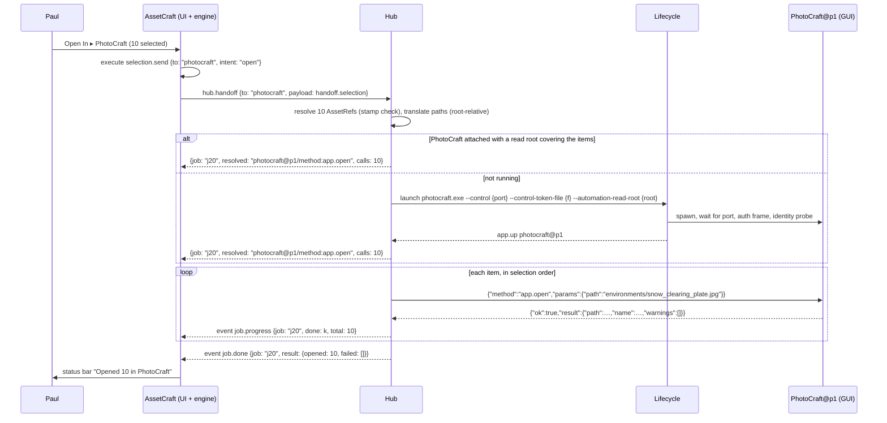
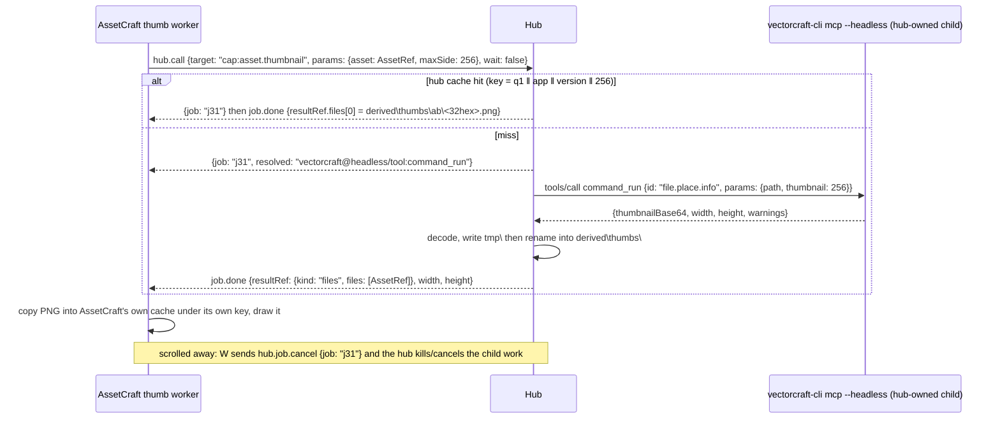
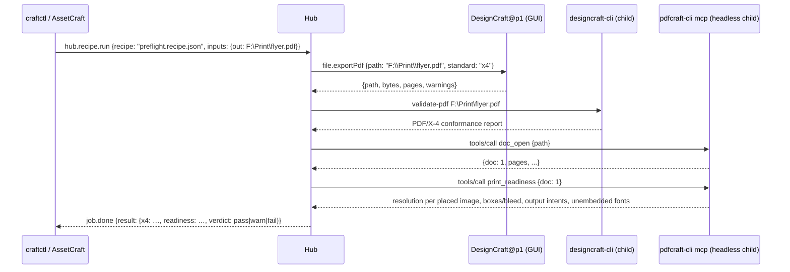

# PipelineCraft (working name): §8 Events, jobs and long-running work · §9 Cross-app workflows

_2026-10-15 · spec draft v0 · status: draft (agent A6)_

- **Scope:** how the hub tells clients that something happened (§8.1–8.3: event frames, topics, filters, back-pressure, and the pollers and MCP progress streams that feed them), how it runs work that outlives a request (§8.4: the job model, cancel, timeouts, result location, `ran`), how it chains calls into recipes with a dry run and undo (§8.5–8.6), and the acceptance workflows end to end (§9: AC1 Open In, AC2 Thumbnails, AC3 Plan → FilmCraft, AC4 the same over MCP, recipes, and the later PrepressCraft and screen-capture cases).
- **Project goal it serves:** G3 Chain, G4 Observe and G5 Automate from §1.2, so that AssetCraft → StoryCraft → FilmCraft (later PrepressCraft) hand work to each other locally, and AC1–AC4 (§1.4) can be run and checked on Paul's machine.
- **Immediate area of improvement:** no Craft app pushes events today, four apps have pollable job lists in four different shapes, and the other five have no job model at all (PdfCraft only reports pending opens) (03a O8, 03b O-B13). This section turns that into one event stream and one job model, entirely hub-side, and names the few AssetCraft Stage 1.5 commands that let AssetCraft be the first app that doesn't need polling.

**Evidence basis.** Static read only; nothing was built or run. Wave 1–2 facts are cited by ID: `01` = §1–2 (A1), `03a` (O1–O14), `03b` (O-B1–O-B13), `04-05` (A3-*), `06` (A4-*), `07` (A5-*). Their names are used verbatim: event frame `{event, sub, seq, source, at, data}`, hub methods `hub.subscribe`, `hub.job.*`, `hub.batch` with reserved `as`/`from`, error codes and `ran` (§6.5), command effects = four classes + `destructive` (A4-R2), AssetRef and `handoff.*` payloads (§7.1.5, §7.2), hub folders under `%LOCALAPPDATA%\PipelineCraft\` (§7.5). Where this section needed a detail those docs lack, it re-read the source at the commits below and cites `repo` `path:line` @ commit. Terms follow §2: **connection** (never "session") for a hub client link, **command effect** in prose.

| Repo         | Commit    | Repo          | Commit    |
|--------------|-----------|---------------|-----------|
| `assetcraft` | `3a41b2b` | `designcraft` | `7ed5697` |
| `photocraft` | `fd28da5` | `effectcraft` | `2c08f67` |
| `lightcraft` | `38adc17` | `vectorcraft` | `0946bc5` |
| `filmcraft`  | `9ed9650` | `soundcraft`  | `3a28a65` |
| `pdfcraft`   | `ac89a11` | `wordcraft`   | `3292ba0` |

**New facts found in this pass (not in waves 1–2):**

| ID     | Fact                                                                                                                                                                                                                                                                                                                                                                 | Source                                                                                                                                                          |
|--------|----------------------------------------------------------------------------------------------------------------------------------------------------------------------------------------------------------------------------------------------------------------------------------------------------------------------------------------------------------------------|-----------------------------------------------------------------------------------------------------------------------------------------------------------------|
| A6-F1  | LightCraft's background export (`app.export {…, background: true}`) replies `{"background": true, "total": n}` with **no activity id**, and a finished task simply disappears from `activity.list` (the list is "tasks in flight"). The hub can only find the task by diffing `activity.list` for a new `kind: "export"` entry, and gets no result list when it ends | `lightcraft` `crates/ui-egui/src/control.rs:523-526`; `crates/ui-egui/src/export_task.rs:52`, `:85`; `crates/engine/src/cmd/activity.rs:14` @ `38adc17`         |
| A6-F2  | FilmCraft jobs have no `state` field: `jobs.list` returns a bare array of `{id, label, progress, etaSeconds, done, total, status, finished, result}`, where failure is `result: {"error": …}`. `jobs.cancel {job}` sets a cooperative flag and returns `null`                                                                                                        | `filmcraft` `crates/engine/src/lib.rs:471-485`; `crates/engine/src/commands.rs:1606-1613` @ `9ed9650`                                                           |
| A6-F3  | EffectCraft `jobs.list` returns `{running, finished}` (two lists), and `jobs.wait` blocks until every job ends with **no timeout**. Over a control channel that blocks the app's UI thread and ends in a bare `timeout` (`ran: maybe`)                                                                                                                               | `effectcraft` `crates/engine/src/commands/panels_cmds.rs:15-28`, `:230-232` @ `2c08f67`                                                                         |
| A6-F4  | FilmCraft `file.import` of an OTIO file is **not idempotent**: `merge_into` gives every imported item, track and clip a fresh id and never matches media already in the project, so importing the same file twice gives two sequences and two copies of every media item. De-duplication by the string `file:{path}` happens only inside one document (A5-O6)        | `filmcraft` `crates/interchange/src/lib.rs:426-431`; `crates/interchange/src/otio.rs:696-698` @ `9ed9650`                                                       |
| A6-F5  | FilmCraft `file.import` can write user files and start more work depending on project preferences: Project Settings ▸ Ingest (copy, transcode, create proxies) and automatic transcription run inside the same call                                                                                                                                                  | `filmcraft` `crates/engine/src/commands.rs:1402-1422` @ `9ed9650`                                                                                               |
| A6-F6  | FilmCraft `file.import` replies `ok: true` with an `errors: [str]` list when some paths failed; it only fails as a whole when nothing imported. Result: `{items, sequences, documents: [{format, sequences, linkedMedia, offlineMedia, report}], errors}`                                                                                                            | `filmcraft` `crates/engine/src/commands.rs:1396-1398`, `:1423-1429`; `crates/engine/src/interchange.rs:100-106` @ `9ed9650`                                     |
| A6-F7  | Undoing an OTIO import in FilmCraft takes **1 + m steps**: one `Import <name>` edit, then one `Link Media` edit per media file that was found on disk. `edit.undo` returns `{"undone": "<label>"}` and `history.list` returns the labels                                                                                                                             | `filmcraft` `crates/engine/src/interchange.rs:53`, `:79-85`; `crates/engine/src/commands.rs:1615`, `:3397-3398`; `crates/engine/src/lib.rs:983-991` @ `9ed9650` |
| A6-F8  | FilmCraft's own OTIO export writes media URLs **relative to the export folder** (the engine sets `relative_to` to the `.otio` file's parent). A5's Not verified step 8 assumes `relative_to` is unset; that holds for the interchange crate's default, not for `file.exportOtio` / `file.exportInterchange`                                                          | `filmcraft` `crates/engine/src/interchange.rs:137`; `crates/interchange/src/otio.rs:240-242` @ `9ed9650`                                                        |
| A6-F9  | `test_data/library` has **no file AssetCraft can't already thumbnail**: its 37 files are jpg, png, webp, gif, tiff, bmp, psd, dng, heic, pdf, mp4, mov, webm, avi, glb, gltf and obj, all covered by Stage 1 decoders. AC2 needs new fixtures to be testable                                                                                                         | `find assetcraft/test_data/library -type f` @ `3a41b2b`; `STATUS.md` Stage 1 steps 1–7                                                                          |
| A6-F10 | Every app has an undo command (`edit.undo`), but only VectorCraft can group several commands into one undo step (`edit.undoGroup.begin {label?}` … `edit.undoGroup.end`), written for automation batches. AssetCraft has no undo (its commands are navigation and view state)                                                                                        | `vectorcraft` `crates/engine/src/cmd/edit.rs:59-66` @ `0946bc5`; per-app rows in §8.6.3                                                                         |
| A6-F11 | PdfCraft already has preflight building blocks as typed, read-only MCP tools: `print_readiness {doc}` (effective image resolution, page boxes and bleed, output intents, unembedded fonts, PDF/A-2b result; "does not check PDF/X") and `pdfa_verify {doc, level: 2b\|3b}`. PDF/X-4 checks exist only in `designcraft-cli validate-pdf FILE.pdf`                     | `pdfcraft` `crates/automation/src/tools.rs:989-995` @ `ac89a11`; `designcraft` `apps/designcraft-cli/src/main.rs:16`, `:123`, `:155` @ `7ed5697`                |
| A6-F12 | AssetCraft's `Session` already keeps a `generation` counter that every `execute` bumps, which is the cheapest possible "did anything change" probe for a selection poller                                                                                                                                                                                            | `assetcraft` `crates/engine/src/lib.rs:156`, `:210-220` @ `3a41b2b`                                                                                             |

---

## 8. Events, jobs and long-running work

### 8.1 Event subscription

#### 8.1.1 Frame

The event frame is A4's, unchanged (§6.1.1, §6.2.6). This section fixes its fields.

```json
{"event": "job.progress", "sub": "s1", "seq": 42, "source": "photocraft@p1",
 "at": "2026-10-15T09:12:03.120Z",
 "data": {"job": "j7", "progress": {"fraction": 0.4, "done": 4, "total": 10, "unit": "count", "message": "Gaussian Blur"}}}
```

| Field    | Type             | Rule                                                                                                                                                                                    |
|----------|------------------|-----------------------------------------------------------------------------------------------------------------------------------------------------------------------------------------|
| `event`  | string           | The topic (§8.2). Lowercase dotted, same grammar as a command id                                                                                                                        |
| `sub`    | string           | The subscription id from `hub.subscribe`. One connection can hold several                                                                                                               |
| `seq`    | u64              | Per subscription, starts at 1, strictly increasing, **never reused**. A dropped frame still consumes its number, so a gap is always visible                                             |
| `source` | string           | `hub`, or `<app>@<instance>` (§6.2.2 instance ids), never a bare app id                                                                                                                 |
| `at`     | RFC 3339 UTC, ms | When the hub observed the change (for polled sources, the poll that saw it), not when the app did it                                                                                    |
| `data`   | object           | Topic-specific (§8.2). Unknown fields must be ignored (rule D-1)                                                                                                                        |
| `origin` | string, optional | `push` (an app or MCP child said so), `poll` (the hub inferred it from a diff), `lifecycle` (discovery or the job manager). Omitted means `lifecycle`. Lets a client judge latency (P4) |

#### 8.1.2 Subscribe and unsubscribe

```json
→ {"id": 30, "method": "hub.subscribe", "params": {
     "topics": ["job.*", "app.up", "app.down"],
     "filter": {"app": ["photocraft", "lightcraft"], "scope": "mine"},
     "replay": "state", "maxQueue": 1024}}
← {"id": 30, "ok": true, "result": {"sub": "s1", "topics": ["job.*", "app.up", "app.down"], "replayed": 3}}
→ {"id": 31, "method": "hub.unsubscribe", "params": {"sub": "s1"}}
← {"id": 31, "ok": true, "result": {}}
```

| Param             | Type                        | Rule                                                                                                                                                                                                                                     |
|-------------------|-----------------------------|------------------------------------------------------------------------------------------------------------------------------------------------------------------------------------------------------------------------------------------|
| `topics`          | `[pattern]`, 1–32           | `*` matches one segment, `**` as the last segment matches the rest (the same globs as A4's effects rules, §6.4.3). `job.*`, `app.*`, `**`                                                                                                |
| `filter.app`      | string or `[string]`        | Only events whose `source` is that app                                                                                                                                                                                                   |
| `filter.instance` | string                      | `photocraft@p1`                                                                                                                                                                                                                          |
| `filter.job`      | string or `[string]`        | Only events about these hub jobs (and their child jobs, §8.4.1)                                                                                                                                                                          |
| `filter.scope`    | `mine` (default) or `all`   | `mine` = job events for jobs this connection started, plus every non-job event. `all` needs the permission A8 defines for watching other connections' work (§11.4); `craftctl watch` and the status panel ask for it                     |
| `replay`          | `none` (default) or `state` | `state` sends one synthetic event per current fact before live events: `app.up` per attached instance, `job.progress` per running job in scope. Replay frames carry `"replay": true` in `data`. This is how a client resyncs after a gap |
| `maxQueue`        | 16–4096, default 1024       | The subscription's queue length in frames (§8.1.3)                                                                                                                                                                                       |

All filter keys AND together. Limits: 8 subscriptions per connection, 64 per hub. Subscriptions die with their connection; there is no durable subscription in v1.

#### 8.1.3 Delivery, back-pressure and drop policy

The hub never blocks an app adapter or the job manager on a slow client. Each subscription has a bounded queue, and one writer per connection drains its subscriptions' queues to the socket in `seq` order per subscription.

| ID  | Rule                                                                                                                                                                                                                                                                                                            |
|-----|-----------------------------------------------------------------------------------------------------------------------------------------------------------------------------------------------------------------------------------------------------------------------------------------------------------------|
| B1  | **Coalescing first.** Frames are tagged `coalesce` or `keep` (§8.2 table). A new `coalesce` frame **replaces** the queued, unsent frame with the same key (topic + job, or topic + instance), and takes a new `seq`. `job.progress` and `export.queue.changed` coalesce; the latest state is all a client needs |
| B2  | **Rate cap.** Per subscription, at most 4 `job.progress` frames per second per job, and at most 2 `app.*.changed`-style frames per second per instance (later ones coalesce under B1). P4's ≤ 100 ms latency target applies to the first frame after a change, not to every intermediate progress tick          |
| B3  | **Terminal frames are never dropped.** `job.done`, `job.failed`, `job.cancelled`, `job.lost`, `app.down` and `sub.closed` are `keep` frames and are always queued, even past `maxQueue` (up to 2 × `maxQueue`)                                                                                                  |
| B4  | **Overflow.** When the queue is full of `keep` frames and a non-terminal `keep` frame arrives, the **oldest non-terminal** frame is dropped. The hub then queues one `sub.dropped {fromSeq, toSeq, count}` frame (itself `keep`, coalescing with an unsent `sub.dropped` by widening the range)                 |
| B5  | **Give up.** If the queue reaches 2 × `maxQueue`, or the socket has accepted nothing for 5 s, the hub sends `sub.closed {reason: "overflow" \| "stalled"}` when it can, removes the subscription, and keeps the connection. The client resubscribes with `replay: "state"` and calls `hub.job.list`             |
| B6  | **Ordering.** Within one subscription, frames from one `source` arrive in the order the hub observed them. Across sources there is no order. A job's terminal frame is always the last frame for that job                                                                                                       |
| B7  | **Size.** An event frame is at most 64 KiB serialized. A job result larger than that is never put in `job.done`; the frame carries `resultSize` and the client calls `hub.job.get` (results up to the 32 MiB reply limit, §6.1.4)                                                                               |
| B8  | **No echo of params.** Events never carry a command's params, which can hold paths and text (§11). They carry the job id and target; `hub.job.get` returns more to a connection allowed to see it                                                                                                               |

#### 8.1.4 Rust type sketch

```rust
// craft-hub-core::events (sketch; no unwrap/expect/panic, closed types for untrusted input)
#[derive(Debug, Clone, serde::Serialize)]
pub struct EventFrame {
    pub event: Topic,              // validated dotted name
    pub sub: SubId,
    pub seq: u64,
    pub source: Source,            // Hub | Instance(AppId, InstanceId)
    pub at: Timestamp,
    #[serde(skip_serializing_if = "Option::is_none")]
    pub origin: Option<Origin>,    // Push | Poll | Lifecycle
    pub data: serde_json::Value,   // built from typed payloads below, never from app bytes directly
}

#[derive(Debug, Clone, Copy, PartialEq, Eq)]
pub enum Retention { Coalesce, Keep, Terminal }

pub struct SubQueue {              // bounded; B1–B5 live here and are unit-tested with a fake clock
    cap: usize,                    // maxQueue
    frames: std::collections::VecDeque<(Retention, CoalesceKey, EventFrame)>,
    next_seq: u64,
}
```

### 8.2 Core events

| Topic                  | Source                | Origin                   | `data`                                                                                     | Retention | Notes                                                                                        |
|------------------------|-----------------------|--------------------------|--------------------------------------------------------------------------------------------|-----------|----------------------------------------------------------------------------------------------|
| `app.up`               | instance              | lifecycle                | `{instance, app, version, mode: gui\|headless, state: ok\|untested, transport}`            | keep      | After attach or launch (§5.3)                                                                |
| `app.down`             | instance              | lifecycle                | `{instance, reason: exited\|stopped\|crashed}`                                             | terminal  | Pid gone (§5.4). Running hub jobs on it end `lost` or `failed` first                         |
| `app.unreachable`      | instance              | lifecycle                | `{instance, since}`                                                                        | keep      | Pid alive, reconnect failed (§5.4)                                                           |
| `app.launch_failed`    | hub                   | lifecycle                | `{app, reason, logTail}`                                                                   | keep      | §5.3 step 4                                                                                  |
| `app.headless_failed`  | hub                   | lifecycle                | `{app, restarts}`                                                                          | keep      | 3 restarts in 60 s (§5.4)                                                                    |
| `app.commands_changed` | instance              | lifecycle                | `{instance, registryHash}`                                                                 | coalesce  | Catalog refetched with a different hash (§6.6.2 D-6)                                         |
| `job.created`          | hub or instance       | lifecycle                | `{job, parent?, target, resolved?, kind, connection}`                                      | keep      | Every hub job (§8.4)                                                                         |
| `job.progress`         | instance              | poll or push             | `{job, progress: {fraction?, done?, total?, unit?, message?}, state: running\|cancelling}` | coalesce  | `fraction` null when the app can't tell                                                      |
| `job.done`             | instance              | poll, push or lifecycle  | `{job, result?, resultSize?, resultRef?, warnings?}`                                       | terminal  | §8.4.5 result location                                                                       |
| `job.failed`           | instance or hub       | any                      | `{job, error}` (§6.5.1 error object, with `ran`)                                           | terminal  |                                                                                              |
| `job.cancelled`        | instance or hub       | any                      | `{job, ran: no\|yes}`                                                                      | terminal  | `ran: yes` = it had started; nothing more changes                                            |
| `job.lost`             | hub                   | lifecycle                | `{job, error}` with `error.ran: "maybe"`                                                   | terminal  | Outcome unknown: app gone, timeout, or vanished from its list (§8.4.2)                       |
| `export.queue.changed` | `filmcraft@…`         | poll                     | `{items: [{id, status, progress, path, error?}]}` from `export.queue.list`                 | coalesce  | A3's topic, kept (04-05 §4.1)                                                                |
| `transport.changed`    | `soundcraft@…`        | poll                     | the `transport.status` result                                                              | coalesce  | A3's topic, kept; only with a subscriber                                                     |
| `selection.changed`    | `assetcraft@…`        | push (Stage 1.5) or poll | `{selected: [path], focus, generation}`                                                    | coalesce  | §8.3.4. No other app has a source for it                                                     |
| `asset.moved`          | `assetcraft@…` or hub | push or lifecycle        | `{from: AssetRef, to: path}`                                                               | keep      | A5 §7.4.5; triggers relink **offers**, never relinks                                         |
| `asset.changed`        | `assetcraft@…` or hub | push or lifecycle        | `{ref: AssetRef, what: content\|metadata\|deleted}`                                        | keep      | A5                                                                                           |
| `asset.hashed`         | hub                   | lifecycle                | `{ref: AssetRef, full}`                                                                    | keep      | End of a `full_hash` job (A5 §7.1.3)                                                         |
| `handoff.recorded`     | hub                   | lifecycle                | `{ledgerId, job, app, appLocal}`                                                           | keep      | One per ledger row (A5 §7.4.6)                                                               |
| `recipe.step`          | hub                   | lifecycle                | `{job, run, step, state, resolved?}`                                                       | keep      | Recipe runs are jobs with child jobs (§8.5); this is the per-step summary for `craftctl run` |
| `sub.dropped`          | hub                   | lifecycle                | `{fromSeq, toSeq, count}`                                                                  | keep      | B4                                                                                           |
| `sub.closed`           | hub                   | lifecycle                | `{reason: overflow\|stalled\|hub_stopping}`                                                | terminal  | B5                                                                                           |

Not adopted: A3's `open.done` for PdfCraft pending opens (04-05 §4.1). A PdfCraft `ui.open` is part of an Open In hub job, so its completion is that job's `job.progress` / `job.done`. Recorded as A6-R7 for the integrator.

### 8.3 Event sources

No app pushes anything on a control channel (01 §1.1; 03a O8; 03b O-B13). The hub has four sources:

| Source                                                | What it produces                                                                                                                             | Section      |
|-------------------------------------------------------|----------------------------------------------------------------------------------------------------------------------------------------------|--------------|
| Lifecycle (discovery, health, launch)                 | `app.*`                                                                                                                                      | A3 §5.3–5.4  |
| Job manager                                           | `job.created`, terminal events for blocking calls and CLI children, `job.lost`, `recipe.step`                                                | §8.4         |
| **Pollers** (one per app instance, only while needed) | `job.progress` and terminal events for app-side jobs, `export.queue.changed`, `transport.changed`, `selection.changed` (AssetCraft fallback) | §8.3.1–8.3.2 |
| **MCP progress** from headless children the hub owns  | `job.progress`, terminal events, with real push and cancel                                                                                   | §8.3.3       |

#### 8.3.1 Pollers: what to poll

Each row is a real command or method, with the reply shape the poller diffs. Cites are at the commits in the header.

| App                                 | Poll call (adapter kind)                                        | Reply shape                                                                                                                                                                                             | Hub job ↔ app job key                                                                                                                                                                 | "Finished" test                                                                          | Cite                                                                                                                                   |
|-------------------------------------|-----------------------------------------------------------------|---------------------------------------------------------------------------------------------------------------------------------------------------------------------------------------------------------|---------------------------------------------------------------------------------------------------------------------------------------------------------------------------------------|------------------------------------------------------------------------------------------|----------------------------------------------------------------------------------------------------------------------------------------|
| PhotoCraft                          | control method `jobs.list` (`control-jsonl`)                    | `{"jobs": [JobInfo]}`, `JobInfo = {id, command, label, document?, state: running\|done\|failed\|cancelled, progress 0–1, message, elapsedMs, result?, error?}`; running jobs plus the **last 16** ended | `id` from `engine.execute {…, wait: false}` → `{job, pending: true}`                                                                                                                  | `state != "running"`                                                                     | `photocraft` `crates/engine/src/jobs.rs:133-152`, `:228`, `:600-604`, `:842-852`; `crates/ui-egui/src/control.rs:33`, `:311`           |
| LightCraft                          | `engine.execute activity.list`                                  | `{"tasks": [{id, kind, label, done, total, unit: count\|bytes\|percent, detail, cancellable, cancelling, ageMs}]}`, in-flight tasks only                                                                | **No id is returned** by the starting call (A6-F1): the poller snapshots ids before the call and adopts the one new task whose `kind` matches the profile (`export` for `app.export`) | The task is **gone** from the list                                                       | `lightcraft` `crates/engine/src/cmd/activity.rs:9-17`; A6-F1                                                                           |
| FilmCraft                           | `engine.execute jobs.list`                                      | bare array of `{id, label, progress, etaSeconds, done, total, status, finished, result}` (A6-F2)                                                                                                        | `job` in the reply of `file.exportMedia` (`{job, path}`; `wait` defaults to false) and other job starters                                                                             | `finished == true`; failure if `result.error`                                            | `filmcraft` `crates/engine/src/lib.rs:471-485`; `crates/engine/src/export_tools.rs:545-548`; `crates/engine/src/commands.rs:1597-1606` |
| FilmCraft                           | `engine.execute export.queue.list`                              | `{"items": [{id, sequence, sequenceName, preset, format, path, range, status, progress, etaSeconds, statusText, job, error, offlineMedia}]}`                                                            | queue item `id` from `export.queue.add`                                                                                                                                               | `status` is a terminal queue status (`done`, failed, cancelled; exact enum not verified) | `filmcraft` `crates/engine/src/export_tools.rs:629-649`, `:1151-1166`                                                                  |
| EffectCraft                         | `engine.execute jobs.list`                                      | `{"running": [...], "finished": [...]}` (A6-F3); job names are `render`, `track`, `maskTrack`, `warp`, `camera`, `roto`, `task:<n>`                                                                     | the job name the starting command implies (`renderQueue.render {wait: false}` → `render`), matched against `running` before and after                                                 | moved to `finished`                                                                      | `effectcraft` `crates/engine/src/commands/panels_cmds.rs:15-18`, `:230-231`; `crates/engine/src/commands/render_queue.rs:671-683`      |
| EffectCraft                         | `engine.execute renderQueue.list`                               | `{items, rendering, progress}`                                                                                                                                                                          | render queue item ids from `renderQueue.render` reply `{rendering, items}`                                                                                                            | `rendering == false` and the items' status                                               | `effectcraft` `crates/engine/src/commands/render_queue.rs:690-694`, `:1048-1050`                                                       |
| PdfCraft                            | control method `ui.state` → `pending_opens` (`control-jsonrpc`) | list of opens still in progress after `ui.open` replied `{accepted, pending: true}`                                                                                                                     | the path sent to `ui.open`                                                                                                                                                            | the path left `pending_opens`                                                            | 03a §3a.5 (`pdfcraft` `crates/ui-egui/src/control.rs:39-40`)                                                                           |
| SoundCraft                          | `engine.execute transport.status`                               | transport state (shape not re-read)                                                                                                                                                                     | none (not a job)                                                                                                                                                                      | n/a                                                                                      | 03b §3.1b SoundCraft; 04-05 §4.1                                                                                                       |
| AssetCraft (until it pushes)        | `engine.execute selection.get` (proposed, §9.7)                 | `{selected, focus, generation}`                                                                                                                                                                         | none                                                                                                                                                                                  | `generation` changed                                                                     | A6-F12; proposal S15-1                                                                                                                 |
| WordCraft, DesignCraft, VectorCraft | none: no job list                                               | n/a                                                                                                                                                                                                     | n/a                                                                                                                                                                                   | the hub job ends when the call returns                                                   | 03a §3a.6; 03b §3.1b                                                                                                                   |

Never polled, on purpose: EffectCraft `jobs.wait` (blocks the UI thread with no timeout, A6-F3) and any `ui.*` method (they act on the window). Both are on the poller's deny-list in the profile (`poll.deny = ["jobs.wait", "ui.**"]`).

#### 8.3.2 Poller rules: interval, start and stop

These refine A3's draft table (04-05 §4.1, "250 ms while a hub job is open there, else off") without changing its intent.

| ID  | Rule                                                                                                                                                                                                                                                                                                                                                                                                            |
|-----|-----------------------------------------------------------------------------------------------------------------------------------------------------------------------------------------------------------------------------------------------------------------------------------------------------------------------------------------------------------------------------------------------------------------|
| P-1 | **One poller per instance**, not per job. It runs every call the profile lists for that instance (`poll.jobs`, `poll.export_queue`, …) in one tick, on one pooled adapter connection (A4: 2–4 per instance, §6.1.4)                                                                                                                                                                                             |
| P-2 | **Start** when the first hub job that needs polling on that instance enters `running`, or when a subscription's topics and filter match a topic only that poller produces (`transport.changed`, `export.queue.changed`, `selection.changed`). **Stop** 2 s after the last such job ends and no such subscription remains. An idle hub sends nothing to apps (04-05 §4.1)                                        |
| P-3 | **Adaptive interval.** 250 ms for the first 5 s of the oldest open job, then 1 s, then 2 s after 60 s. Any observed change resets to 250 ms for 5 s. Subscriber-only pollers (`transport.changed`) run at 1 s. Reason: every poll runs on the app's **UI thread** (control requests are executed by the window's frame loop, 06 §6.1.4 "Hub→app concurrency"), so a long render should not cost the user frames |
| P-4 | **Single flight.** At most one poll in flight per instance. A tick that comes due while the previous poll is still out is skipped, not queued                                                                                                                                                                                                                                                                   |
| P-5 | **Errors are not job outcomes.** `app_busy` with `ran: no` (LightCraft's hidden-window rule: "the app drew no frame for 5 s", 06 §6.5.3) and `timeout_not_run` skip the tick. Three consecutive `timeout_unknown` or `app_disconnected` hand the instance to the health check (04-05 §5.4) and pause the poller; jobs stay `running` until the instance is declared down, then become `lost`                    |
| P-6 | **Diff, then emit.** The poller keeps the last snapshot per key and emits only differences: new progress (subject to B2), a state change, or a vanished entry. A vanished entry with no terminal state is: LightCraft → `job.done` with `result: null` and a `result_unknown` warning (A6-F1); PhotoCraft (fell out of the 16-entry ring between polls) → `job.lost`                                            |
| P-7 | **Cheap first.** For AssetCraft, `selection.get` returns `generation`; the poller asks for the full selection only when it changed. For FilmCraft, `export.queue.list` is polled only while an export-queue job is open or a subscriber wants `export.queue.changed`                                                                                                                                            |
| P-8 | **No invented methods.** Pollers only call ids present in the instance's live catalog or the adapter's method table, never a hub-made name (WordCraft runs unknown methods as commands, A3-O6)                                                                                                                                                                                                                  |

#### 8.3.3 MCP progress from headless children: the real push source

When the router picks the `mcp-stdio` adapter (04-05 §4.4), the hub is an MCP client of a child it owns, and that child can push progress. The hub sends a `progressToken` in `_meta` on `tools/call`, turns each `notifications/progress {progressToken, progress, total?, message?}` into `job.progress` (origin `push`), and cancels with `notifications/cancelled {requestId, reason}`.

| App (headless)                                            | Call that streams progress                                                                            | Cancel honoured                 | Cite                                                                                             |
|-----------------------------------------------------------|-------------------------------------------------------------------------------------------------------|---------------------------------|--------------------------------------------------------------------------------------------------|
| PhotoCraft                                                | `command_run {id: "file.export.renderVideo", …}`                                                      | yes                             | 03a §3a.2 (`photocraft` `crates/automation/src/server/progress.rs:9-40`; `conventions.rs:52-57`) |
| LightCraft                                                | headless batch export (`export` tool)                                                                 | yes (`notifications/cancelled`) | 03a §3a.3 (`lightcraft` `crates/mcp/src/progress.rs:1`, `:111`, `:138-139`)                      |
| FilmCraft                                                 | `command_run {id: "file.exportMedia", params: {…, wait: true}}`, polled inside the child every 100 ms | yes                             | 03a §3a.4 (`filmcraft` `crates/automation/src/long_job.rs:1-66`)                                 |
| EffectCraft                                               | blocking `renderQueue.render` in headless mode                                                        | yes                             | 03b §3.1b (`effectcraft` `crates/automation/src/long_job.rs:1-6`; `docs/mcp.md:54-85`)           |
| PdfCraft, WordCraft, DesignCraft, VectorCraft, SoundCraft | none (servers ignore progress)                                                                        | no                              | 03a §3a.5–3a.6; 03b §3.1b                                                                        |

Routing consequence (rule R-MCP): for a job with **no GUI requirement** (thumbnails, recipe renders, batch exports), the router prefers the headless MCP child when the target command is in the table above, because it gives push progress and a real cancel. For a job the user must see in a window (Open In, AC3's timeline), the GUI instance and a poller are used instead. The profile key is `progress = "mcp-push" | "poll" | "none"` per command pattern.

#### 8.3.4 AssetCraft: the first app that pushes

AssetCraft's Stage 1.5 control server is new code (03b O-B9; A3-O1 makes it the manifest reference), so it can push from day one instead of being polled. Proposal (owner Claude, Paul approves; details in §9.7):

- Control **method** `events.subscribe {topics: [pattern]}` on AssetCraft's own `--control` channel, replying `{sub}` and then pushing frames of the **same shape** as §8.1.1 (`{"event", "sub", "seq", "source", "at", "data"}`) for `selection.changed`, `location.changed`, `asset.changed` (from the folder watcher, `STATUS.md` step 3) and `asset.moved` (watcher renames, A5 §7.4.5).
- The hub's `control-jsonl` adapter forwards those frames into the bus with `origin: "push"`. That proves the frame shape on one app before the upstream `events.subscribe` ask (03a O8; 03b O-B13; A1-O5).
- Until it lands, `selection.get` + `generation` is the poll fallback (P-7).

### 8.4 Jobs

#### 8.4.1 Job object

Every `hub.call` with `wait: false`, every `hub.batch` / recipe run, every `hub.handoff` (§9.0.1) and every hub-internal task (GC, full hashing) is a hub job. `hub.job.list`, `hub.job.get`, `hub.job.wait` and `hub.job.cancel` are A4's names (§6.2.1); this is their payload.

```json
{
  "job": "j12",
  "parent": null,
  "kind": "app-job",
  "target": "photocraft/filter.blur.gaussianBlur",
  "resolved": "photocraft@p1/filter.blur.gaussianBlur",
  "connection": "c-7f3a",
  "state": "running",
  "progress": {"fraction": 0.4, "done": null, "total": null, "unit": null, "message": "Gaussian Blur"},
  "createdAt": "2026-10-15T09:12:03.004Z", "startedAt": "2026-10-15T09:12:03.010Z", "endedAt": null,
  "timeoutMs": 1800000,
  "cancel": {"supported": true, "via": "photocraft/jobs.cancel"},
  "progressSource": "poll",
  "appJob": {"app": "photocraft", "key": 31},
  "children": [],
  "result": null, "resultRef": null, "error": null,
  "ran": "yes"
}
```

| Field            | Rule                                                                                                                                                                                                                                                                                 |
|------------------|--------------------------------------------------------------------------------------------------------------------------------------------------------------------------------------------------------------------------------------------------------------------------------------|
| `job`            | Hub-scoped string `j<n>`, never reused while the hub runs. App job numbers are per app and live in `appJob.key` (06 Example 8)                                                                                                                                                       |
| `parent`         | Set on child jobs: one per item of a fan-out (Open In of 10 files) and one per recipe step                                                                                                                                                                                           |
| `kind`           | `app-job` (the app has its own job, polled or pushed), `blocking-call` (one request that returns when done, run on a hub worker), `cli-child` (a `cli-headless` process), `mcp-call` (an `mcp-stdio` call), `composite` (a fan-out, batch or recipe; its progress is the children's) |
| `state`          | §8.4.2                                                                                                                                                                                                                                                                               |
| `progress`       | `fraction` 0–1 or null; `done`/`total`/`unit` when the app reports counts (LightCraft `unit: count\|bytes\|percent`, FilmCraft `done`/`total`). A composite's `fraction` is finished children ÷ children                                                                             |
| `timeoutMs`      | §8.4.4                                                                                                                                                                                                                                                                               |
| `cancel`         | What `hub.job.cancel` will do (§8.4.3). `supported: false` is honest: cancel then only stops the hub from waiting                                                                                                                                                                    |
| `progressSource` | `push`, `poll` or `none`                                                                                                                                                                                                                                                             |
| `result`         | Inline result up to 1 MiB serialized; else null and `resultRef` (§8.4.5)                                                                                                                                                                                                             |
| `ran`            | The job-level answer to "did the command run": `no`, `maybe` or `yes` (A4 §6.5.1). Fixed once the job leaves `pending` (see the state table)                                                                                                                                         |

#### 8.4.2 States

```text
            dispatch                     app/child says done
 pending ───────────► running ─────────────────────────────► done
    │                  │  │  └── app error / child non-zero ─► failed
    │ cancel           │  └──── cancel sent ──► cancelling ──► cancelled | done | failed
    ▼                  │                             (the app may finish anyway)
 cancelled (ran: no)   └──── app down / timeout_unknown / vanished ─► lost (ran: maybe)
```

| State        | Meaning                                                                                                                                                                         | `ran`                                                                                                                                            |
|--------------|---------------------------------------------------------------------------------------------------------------------------------------------------------------------------------|--------------------------------------------------------------------------------------------------------------------------------------------------|
| `pending`    | Accepted, not dispatched: waiting for an instance (launching), a pooled connection, a confirmation, or an earlier recipe step                                                   | `no`                                                                                                                                             |
| `running`    | Dispatched; the app (or child) has it                                                                                                                                           | `yes` once the app acknowledged it (`{job, pending: true}`, a new activity task, an MCP progress frame); `maybe` while only the request was sent |
| `cancelling` | Cancel sent to the app; waiting for it to stop                                                                                                                                  | as before                                                                                                                                        |
| `done`       | Finished; `result` / `resultRef` set. A partial success (FilmCraft `errors[]` non-empty, A6-F6) is `done` with `warnings` and `"partial": true`                                 | `yes`                                                                                                                                            |
| `failed`     | Ended with an error object (§6.5.1); the error carries its own `ran`                                                                                                            | from the error                                                                                                                                   |
| `cancelled`  | Stopped by cancel. `ran: no` if it never reached the app, `yes` if it had started (nothing more changes; app-side effects already made stay made)                               | `no` or `yes`                                                                                                                                    |
| `lost`       | The hub can't know the outcome: the instance went down, a blocking call hit `timeout_unknown`, an app job vanished without a terminal state (P-6), or the hub restarted mid-job | `maybe`                                                                                                                                          |

`lost` is new relative to A4's codes; its error object uses A4's `timeout_unknown` or `app_disconnected` codes, so no new error code is needed. A recipe never auto-retries a step that ended `lost` unless the step is `read` or `idempotent` (A4 auto-retry rule, §6.5.1); otherwise it runs the step's **outcome probe** (§8.5.4) or stops and asks.

#### 8.4.3 Cancel: what each app can actually do

| App                                                       | Cancel call                                                                                                                            | Granularity and semantics                                                                                                                                                                               | Cite                                                                                                                                   |
|-----------------------------------------------------------|----------------------------------------------------------------------------------------------------------------------------------------|---------------------------------------------------------------------------------------------------------------------------------------------------------------------------------------------------------|----------------------------------------------------------------------------------------------------------------------------------------|
| PhotoCraft                                                | `jobs.cancel {job?}` (no `job` = every running job) → `{cancelled: n}`                                                                 | Per job; the document is unchanged on cancel. **Printing can't be cancelled** this way (error text says to use the system print queue)                                                                  | `photocraft` `crates/engine/src/jobs.rs:114-121`, `:853-875`                                                                           |
| LightCraft                                                | `activity.cancel {id}` or `{all: true}` → `{cancelled: n}`                                                                             | Only tasks with `cancellable: true`; stops "at its next file or photo"; an unknown id (just finished) is an error, which the hub maps to "already ended"                                                | `lightcraft` `crates/engine/src/cmd/activity.rs:18-34`                                                                                 |
| FilmCraft                                                 | `jobs.cancel {job}` → `null`; `export.queue.cancel {id?, wait?}`; `export.queue.stop {}`                                               | Cooperative flag; the reply doesn't say whether it stopped, so the poller confirms                                                                                                                      | `filmcraft` `crates/engine/src/commands.rs:1608-1613`; `crates/engine/src/export_tools.rs:1160-1161`                                   |
| EffectCraft                                               | `jobs.cancel {job?: render\|track\|maskTrack\|warp\|camera\|roto\|task:<n>\|all}` → `{cancelled}`; `renderQueue.stop {}` → `{stopped}` | By job **kind**, not by instance of work: cancelling `render` stops the whole render queue                                                                                                              | `effectcraft` `crates/engine/src/commands/panels_cmds.rs:20-23`, `:231`; `crates/engine/src/commands/render_queue.rs:686-688`, `:1049` |
| PdfCraft, WordCraft, DesignCraft, VectorCraft, SoundCraft | none                                                                                                                                   | A GUI call can't be stopped once sent. The hub stops waiting and the job ends `cancelled` only if the app hadn't started it (`timeout_not_run`); otherwise it stays `cancelling` until the call returns | 03a §3a.5–3a.6; 03b §3.1b                                                                                                              |
| Any `cli-child`                                           | kill the child (job object, 04-05 §5.3)                                                                                                | Immediate. For a `read` command the job is `cancelled, ran: yes`; for a write it is `cancelled` with `error.ran: "maybe"` and the output path is reported so the caller can check for a partial file    | 04-05 §5.3                                                                                                                             |
| Any `mcp-call` with progress                              | `notifications/cancelled`                                                                                                              | As the app honours it (§8.3.3); if no reply within 10 s, the hub kills the child and the job is `lost`                                                                                                  | §8.3.3                                                                                                                                 |
| AssetCraft                                                | none today (thumbnail workers are internal)                                                                                            | Stage 1.5 proposal: `thumb.render` jobs cancel by dropping the request (§9.7)                                                                                                                           | `assetcraft` `STATUS.md` steps 1–2                                                                                                     |

**AC2(b) consequence:** "cancelling the job stops the app-side work" is only true for `cli-child`, `mcp-call` and the four apps with job lists. Thumbnail jobs are therefore always routed to a headless child (§9.2), never to a GUI window.

#### 8.4.4 Timeouts

Three layers, each with its own error:

| Layer                                           | Default                                                                                                                                                 | On expiry                                                                                                                                                                          |
|-------------------------------------------------|---------------------------------------------------------------------------------------------------------------------------------------------------------|------------------------------------------------------------------------------------------------------------------------------------------------------------------------------------|
| Wire (one request to an app)                    | The app's own reply timeout + 5 s: 65 s for most, 95 s SoundCraft, 35 s PdfCraft (04-05 §4.4 config; 06 §6.5.3)                                         | The app's own `timeout…` text, mapped by A4's table to `timeout_not_run` or `timeout_unknown`                                                                                      |
| Call (`hub.call {timeoutMs}` with `wait: true`) | 60 s; max 10 min. A caller that wants longer uses `wait: false`                                                                                         | `timeout_unknown` (`ran: maybe`) if dispatched, `timeout_not_run` if still `pending`. A blocking call that is still out keeps running as a `lost`-pending job the caller can watch |
| Job (wall clock from `startedAt`)               | `app-job` and `mcp-call` 30 min; `cli-child` 10 min; thumbnails 15 s; `composite` none (its children have their own). Per step in recipes (`timeoutMs`) | Send cancel if supported, wait 10 s, then `cancelled` if the app confirmed, else `lost`. **GUI windows are never killed**; hub-owned children are                                  |

#### 8.4.5 Result location

| Result                                 | Where                                                                                                                                                                                                                                 | Notes                                                              |
|----------------------------------------|---------------------------------------------------------------------------------------------------------------------------------------------------------------------------------------------------------------------------------------|--------------------------------------------------------------------|
| Small JSON (≤ 1 MiB serialized)        | `result`, inline                                                                                                                                                                                                                      | Most commands                                                      |
| Large JSON (1–32 MiB)                  | `resultRef: {kind: "json", path: "%LOCALAPPDATA%\\PipelineCraft\\renders\\<jobId>\\result.json", size}`, fetched with `hub.job.get {job, inline: true}` up to 32 MiB                                                                  | Over 32 MiB is A4's `result_too_large`                             |
| Files the command wrote                | `resultRef: {kind: "files", files: [AssetRef]}`. The hub mints each AssetRef (path + size + mtime + `q1`, A5 §7.1.5) after the job ends, from the paths in the app's reply (`files`, `path`, `paths`) per a profile `outputs` pointer | Lets the next recipe step take them as input (§8.5.2)              |
| Bytes the app returned inline (base64) | Decoded by the hub to `derived\` (thumbnails) or `renders\<jobId>\` (anything else), returned as `files`                                                                                                                              | VectorCraft `thumbnailBase64`, EffectCraft `render.frame {base64}` |
| No destination given by the caller     | `renders\<jobId>\` (A5 §7.5.1 G4, kept 7 days)                                                                                                                                                                                        | Dry runs never write there (A5 G9)                                 |

Job records are kept in memory: running jobs, plus the last 256 ended jobs or 24 h, whichever is fewer. Recipe runs also append to `%LOCALAPPDATA%\PipelineCraft\state\runs\<runId>.jsonl` (one line per step outcome, no params, B8), so `craftctl` can show and undo a past run after a hub restart.

#### 8.4.6 How each kind of work becomes a hub job

| App                                             | How long work starts                                                                                                     | Becomes                                               | Progress                                                   | Cite         |
|-------------------------------------------------|--------------------------------------------------------------------------------------------------------------------------|-------------------------------------------------------|------------------------------------------------------------|--------------|
| PhotoCraft                                      | `engine.execute {command, params, wait: false}` → `{job, pending: true}`                                                 | `app-job`                                             | poll `jobs.list`                                           | 06 Example 8 |
| LightCraft                                      | `app.export {…, background: true}` → `{background, total}`; library imports and preview builds appear in `activity.list` | `app-job` (adopted by diff, A6-F1)                    | poll `activity.list`                                       | A6-F1        |
| FilmCraft                                       | `file.exportMedia {…}` (default `wait: false`) → `{job, path}`; `export.queue.add/start`                                 | `app-job`                                             | poll `jobs.list` / `export.queue.list`; push when headless | §8.3.1       |
| EffectCraft                                     | `renderQueue.render {wait: false}` → `{rendering, items}`                                                                | `app-job`                                             | poll `jobs.list`, `renderQueue.list`; push when headless   | §8.3.1       |
| PdfCraft                                        | control `ui.open {path}` → `{accepted, pending: true}`                                                                   | `app-job`                                             | poll `ui.state`                                            | 03a §3a.5    |
| WordCraft, DesignCraft, VectorCraft, SoundCraft | the call itself                                                                                                          | `blocking-call`                                       | none                                                       | 03a, 03b     |
| Any app's CLI                                   | `<app>-cli …`                                                                                                            | `cli-child`                                           | none (exit code + stdout)                                  | 04-05 §4.4   |
| AssetCraft (Stage 1.5)                          | `thumb.render`, `asset.ref` with hashing                                                                                 | `blocking-call` now; `app-job` once it publishes jobs | push (§8.3.4)                                              | §9.7         |

### 8.5 Chaining and recipes

#### 8.5.1 Format decision: JSON, a superset of `hub.batch`

**Recommendation A6-R4: recipes are JSON files (`*.recipe.json`), and a recipe is a `hub.batch` (§6.2.4) plus named inputs, references between steps, and `forEach`.** Reasons:

| Criterion                                                                    | JSON                                                                                                                                                                                                     | TOML                                                                                                          |
|------------------------------------------------------------------------------|----------------------------------------------------------------------------------------------------------------------------------------------------------------------------------------------------------|---------------------------------------------------------------------------------------------------------------|
| Params are app JSON, often nested (`{"settings": {...}}`, arrays of objects) | Pasted as is from `hub.describe`, `craftctl` or an app's own script                                                                                                                                      | Nested inline tables and arrays of tables read poorly; `null` has no TOML form, and several app params use it |
| Single-app precedents                                                        | PhotoCraft actions `{"command", "params"}` (`photocraft` `apps/photocraft-cli/src/lib.rs:33-39`), FilmCraft `run` lines `{"id","params"}`, DesignCraft `script FILE.jsonl` (01 §2 "Recipe") are all JSON | none                                                                                                          |
| Comments                                                                     | none (a `"note"` field per step instead)                                                                                                                                                                 | yes                                                                                                           |
| One parser for wire and file                                                 | `serde_json`, already in every crate                                                                                                                                                                     | adds `toml` to the hub core (already used for profiles, so not a new dependency)                              |

TOML stays the format for hand-curated tables (profiles, effects), as A3 and A4 chose. A1-O6 is met: a recipe step `{"target": "photocraft/<id>", "params": …}` is a PhotoCraft action step with the app filled in, and `craftctl recipe import --from photocraft-action <file>` (A7) can convert one.

#### 8.5.2 Schema

```json
{
  "recipe": 1,
  "name": "review-export",
  "description": "Import an AssetCraft selection into LightCraft and export 2048 px JPEGs",
  "inputs": {
    "selection": {"type": "handoff.selection", "required": true},
    "longEdge":  {"type": "integer", "default": 2048, "minimum": 64, "maximum": 16384},
    "outDir":    {"type": "folder", "default": "${run.renders}"}
  },
  "steps": [
    {"id": "import", "target": "lightcraft/library.import",
     "params": {"paths": {"$from": "inputs.selection.items[*].path"}, "mode": "add"},
     "as": "imp"},
    {"id": "select", "target": "lightcraft/library.select",
     "params": {"ids": {"$from": "steps.imp.result.imported"}}},
    {"id": "export", "target": "lightcraft/app.export",
     "params": {"ids": {"$from": "steps.imp.result.imported"}, "dir": {"$from": "inputs.outDir"},
                "format": "jpeg", "longEdge": {"$from": "inputs.longEdge"}, "background": true},
     "timeoutMs": 1800000, "as": "exp"},
    {"id": "show", "target": "assetcraft/nav.open", "params": {"path": {"$from": "inputs.outDir"}}}
  ],
  "onError": "stop"
}
```

| Key                              | Rule                                                                                                                                                                                                                                                                           |
|----------------------------------|--------------------------------------------------------------------------------------------------------------------------------------------------------------------------------------------------------------------------------------------------------------------------------|
| `recipe`                         | Format version, integer. Unknown version → refused (`payload_version_unsupported`, A5)                                                                                                                                                                                         |
| `inputs`                         | Named, typed inputs. Types: `string`, `integer`, `number`, `boolean`, `path` (a file), `folder`, `asset` (AssetRef), any `handoff.*` type (A5 §7.2). `default` may use templates (below)                                                                                       |
| `steps[]`                        | Ordered. Each step is a `hub.batch` step `{target, params}` (A4) plus `id` (unique, `[a-z0-9-]{1,32}`), optional `as`, `forEach`, `timeoutMs`, `expect`, `undo`, `note`. Max 256 steps (A4's batch limit)                                                                      |
| `target`                         | Any A4 target: address, `@instance` pin, `kind:` prefix, or `cap:` capability                                                                                                                                                                                                  |
| `as`                             | A4's reserved key: stores this step's outcome under `steps.<as>` as `{result, files, job, resolved}`                                                                                                                                                                           |
| `{"$from": "<ref>"}`             | Anywhere inside `params`, replaced at run time by the value at `<ref>`: `inputs.<name>…`, `steps.<as>.result.<field>…`, `steps.<as>.files[<i>].path`, `run.id`. `[*]` maps over an array. A missing value fails the step with `bad_params` before dispatch (`ran: no`)         |
| `from` (A4's other reserved key) | Shorthand: `"from": "<as>"` = put `steps.<as>.files[*].path` into the target capability's declared input key (`paths` or `path`, from the profile). Only valid with `cap:` targets or commands whose profile declares `input`                                                  |
| `forEach`                        | `{"$from": "<array ref>"}`: run the step once per element, as child jobs, in order, with `${item}` / `{"$from": "item…"}` bound. `concurrency` 1 by default (apps execute one request at a time anyway, 06 §6.1.4), max 4, and only for `read` steps                           |
| `expect`                         | Post-conditions checked after the step, as read-only comparisons on its result: `{"eq": [ref, ref]}`, `{"within": [ref, ref, tolerance]}`, `{"empty": ref}`, `{"nonEmpty": ref}`. A failed expectation ends the step `failed` with code `app_error`, `data.expect`, `ran: yes` |
| `undo`                           | Per-step undo override (§8.6.3); normally derived from the profile                                                                                                                                                                                                             |
| Templates `${…}`                 | Only in strings: `${run.id}`, `${run.renders}` (= `renders\<jobId>\`), `${run.handoff}` (= `handoff\<jobId>\`), `${inputs.<name>}`. **No** environment variables, no shell, no file reads. Paths built by templates must still pass A5's path rules                            |
| `onError`                        | `stop` (default) or `continue` (later steps that reference a failed step are skipped, `ran: no`)                                                                                                                                                                               |

Not in v1 (start small): conditionals, loops other than `forEach`, sub-recipes, and AssetCraft's planned "any-CLI step" (`assetcraft` `docs/assetcraft-plan.md:64`). A recipe file is hostile input (AGENTS non-negotiable 4): parsed into closed types, unknown keys rejected, `$from` refs at most 16 segments, total expanded params checked against the 4 MiB line limit before dispatch.

#### 8.5.3 Where recipes run

New hub methods, proposed here for A4's table (§6.2.1) and A7's `craftctl run` (§12):

| Method                | Params                                                                                                           | Result                                                                                         | Command effect           |
|-----------------------|------------------------------------------------------------------------------------------------------------------|------------------------------------------------------------------------------------------------|--------------------------|
| `hub.recipe.run`      | `{recipe: <object> \| "file:<path>" \| "builtin:<name>", inputs, dryRun?: "plan" \| "probe" \| false, confirm?}` | dry run: `{plan, effects, confirm}`; else `{job, run}` (a `composite` job; one child per step) | union of the steps'      |
| `hub.recipe.undo`     | `{run, dryRun?}`                                                                                                 | `{plan}` or `{job}`                                                                            | union of the undo steps' |
| `hub.recipe.validate` | `{recipe}`                                                                                                       | `{ok, errors, steps: [{id, resolved?, effects}]}`; resolves nothing that needs an instance     | read                     |

`builtin:` recipes ship with the hub as data files and implement the acceptance cases: `builtin:open-in` (AC1, used by `hub.handoff`), `builtin:thumbnail` (AC2), `builtin:plan-to-filmcraft` (AC3).

#### 8.5.4 Outcome probes

A step that ends `lost` (`ran: maybe`) is only retried after a read that tells "it happened" from "it didn't". The probe is profile data per command, not recipe author code:

| Command                                           | Outcome probe                                          | "It ran" when                                                                                                                                                               |
|---------------------------------------------------|--------------------------------------------------------|-----------------------------------------------------------------------------------------------------------------------------------------------------------------------------|
| `filmcraft/file.import`                           | `project.inspect {}` (has `revision` and the bin tree) | `revision` moved past the value captured before the step and a sequence named after the OTIO stem appeared (`filmcraft` `crates/engine/src/commands.rs:3384`, `:4245-4253`) |
| `photocraft/method:app.open`                      | `jobs.list` (file opens run as jobs, 03a §3a.2)        | an `open` job for that path ended `done`                                                                                                                                    |
| `lightcraft/library.import`                       | `library.importPreview {paths}`                        | every candidate reports `existing`                                                                                                                                          |
| `*/file.export*`, `app.export`, `document.export` | the hub stats the output paths                         | each file exists with an mtime after the step started                                                                                                                       |
| anything else                                     | none                                                   | the step stops and the run asks the caller (`craftctl` prompt, MCP confirmation)                                                                                            |

### 8.6 Batch rules: dry run, commit, undo

#### 8.6.1 Dry run per command effect

A4 defines `dryRun: true` on `hub.batch` as "nothing is dispatched" (§6.2.4). Recipes keep that as `dryRun: "plan"` and add one level, `"probe"`, which may run calls that change nothing in an app or a user folder, so later steps can be resolved and checked.

| Command effect (A4-R2)                      | `plan`                                                                                                       | `probe`                                                                                          | Commit                 |
|---------------------------------------------|--------------------------------------------------------------------------------------------------------------|--------------------------------------------------------------------------------------------------|------------------------|
| `read`                                      | not run; listed                                                                                              | **run** (subject to the per-call timeout); results feed `$from` and `expect`                     | run                    |
| `write-app-state`                           | not run; listed with resolved instance, undo availability                                                    | not run; its **shadow** runs if the profile has one (§8.6.2)                                     | run                    |
| `write-user-file`                           | not run; output paths listed, and the hub stats each one: `exists: true` flags an overwrite as `destructive` | run **only if every output path is inside the hub's `handoff\` or `tmp\`** (A5 G9), else not run | run after confirmation |
| `external-network`                          | not run; flagged                                                                                             | not run                                                                                          | run after confirmation |
| `destructive: true`                         | listed with the reason                                                                                       | not run                                                                                          | run after confirmation |
| effects `source: default` (unknown, §6.4.2) | listed as unknown                                                                                            | not run                                                                                          | run after confirmation |

A probe run writes nothing to `renders\` or any user folder, and leaves no app document changed. Steps after a step that wasn't run see placeholders (`"<steps.imp.result.imported>"`) in the plan, and their `$from` refs are checked against the profile's `result` schema when one exists (06 §6.3.1), else marked `unchecked`.

#### 8.6.2 Shadows: real preview commands the apps already have

| Write command                                      | Shadow (read) used in `probe`                 | What the plan gains                                                                       | Cite                                                      |
|----------------------------------------------------|-----------------------------------------------|-------------------------------------------------------------------------------------------|-----------------------------------------------------------|
| `lightcraft/library.import {paths, mode}`          | `lightcraft/library.importPreview {paths}`    | per file: format, size, duplicate (path or content), `existing`                           | `lightcraft` `crates/engine/src/cmd/library.rs:1374-1390` |
| `filmcraft/file.exportMedia`, `export.queue.add`   | `filmcraft/export.resolve {…settings, path?}` | resolved format, size, output path                                                        | `filmcraft` `crates/engine/src/export_tools.rs:1149`      |
| `vectorcraft/file.place {path, …}`                 | `vectorcraft/file.place.info {path, …}`       | what would be placed: size, format, warnings                                              | `vectorcraft` `crates/engine/src/cmd/place/mod.rs:64-72`  |
| `assetcraft/storyline.exportOtio` (proposed, §9.7) | itself, with `path` in `${run.handoff}`       | the real OTIO, clip count and duration, so AC3(d) can check it without touching FilmCraft | §9.3                                                      |

#### 8.6.3 Commit and confirmation

- Commit re-sends the same recipe and inputs with `dryRun: false` and the `confirm` token from the dry run (A4 Example 7). The token is bound to a **plan hash**: recipe hash + inputs hash + every resolved target + the `registryHash` (06 §6.6.2 D-6). If any of these changed (an app restarted, a different instance would be chosen), the token is refused with `confirmation_required` and a fresh plan.
- One confirmation covers the run. Steps that are `read` or `write-app-state` with `confirm: false` never prompt on their own.
- `hub.call` / `hub.batch` without a recipe keep A4's rules unchanged.

#### 8.6.4 Undo where the target supports it

Undo is per app and per document, a stack the user also pushes onto. The hub never assumes "undo once per step".

| App         | Undo command                                                                               | Can verify before undoing?                             | Group several commands? | Cite                                                                                                     |
|-------------|--------------------------------------------------------------------------------------------|--------------------------------------------------------|-------------------------|----------------------------------------------------------------------------------------------------------|
| PhotoCraft  | `edit.undo {}`, `edit.redo {}`                                                             | history commands exist (`history_cmds.rs`)             | no                      | `photocraft` `crates/engine/src/commands.rs:499-500`; `crates/engine/src/history_cmds.rs:56`             |
| LightCraft  | `edit.undo {}` → `{undone}`; also per-photo develop history (`history.list {id?}`)         | per-photo only                                         | no                      | `lightcraft` `crates/engine/src/cmd/edit.rs:7-11`; `crates/engine/src/cmd/query.rs:217`                  |
| FilmCraft   | `edit.undo {}` → `{"undone": label}`; `history.list {}` → `{undo: [label], redo: [label]}` | **yes**, by label                                      | no                      | `filmcraft` `crates/engine/src/commands.rs:1615-1616`, `:3397-3398`                                      |
| PdfCraft    | `edit.undo`, `edit.redo` (registry; reachable through `ui.command {id}` on control)        | labels via the registry's dynamic label (`undo_label`) | no                      | `pdfcraft` `crates/engine/src/commands.rs:193-194`, `:410-411`                                           |
| WordCraft   | `edit.undo {}` (refused while the document is protected)                                   | no                                                     | no                      | `wordcraft` `crates/engine/src/cmd/edit.rs:36-38`                                                        |
| DesignCraft | `edit.undo {}` (a `noundo` command itself)                                                 | no                                                     | no                      | `designcraft` `crates/engine/src/cmd/edit.rs:171-173`                                                    |
| EffectCraft | `edit.undo {}`; `edit.history {steps}` (several steps at once)                             | labels in the history menu                             | no                      | `effectcraft` `crates/engine/src/commands/edit.rs:825-826`; `crates/engine/src/commands/app_more.rs:649` |
| VectorCraft | `edit.undo {}`; **`edit.undoGroup.begin {label?}` / `edit.undoGroup.end`**                 | no                                                     | **yes**                 | `vectorcraft` `crates/engine/src/cmd/edit.rs:59-66`                                                      |
| SoundCraft  | `edit.undo {}` → `{undone}`                                                                | no                                                     | no                      | `soundcraft` `crates/engine/src/cmd/edit.rs:12`                                                          |
| AssetCraft  | none                                                                                       | n/a                                                    | n/a                     | `assetcraft` `crates/engine/src/commands.rs:39-152`                                                      |

Undo rules:

| ID  | Rule                                                                                                                                                                                                                                                                                                                                                                                                                                                                                      |
|-----|-------------------------------------------------------------------------------------------------------------------------------------------------------------------------------------------------------------------------------------------------------------------------------------------------------------------------------------------------------------------------------------------------------------------------------------------------------------------------------------------|
| U1  | A step is undoable only if its command effects say `undoable: true` (curated or declared) **and** the app has `edit.undo`. Otherwise the run log records `undo: none` and `hub.recipe.undo` lists the step as "not reversible"                                                                                                                                                                                                                                                            |
| U2  | **Verify, then pop.** Where labels are readable (FilmCraft `history.list`), the hub checks that the top of the undo stack is exactly what the run pushed (A6-F7: `Link Media` × m, then `Import <name>`) and refuses with `undo_conflict` (proposed code, §6.5) if anything else is on top. Where labels can't be read, undo runs only when the instance's command log shows no other command since the step (the hub saw every call it made; it can't see the user's), and it asks first |
| U3  | **Groups where available.** For VectorCraft, a recipe's consecutive steps on one document are wrapped in `edit.undoGroup.begin {label: "<recipe>: <step>"}` … `edit.undoGroup.end`, so one `edit.undo` reverses them. This is the pattern to propose upstream for every app (A6-O3)                                                                                                                                                                                                       |
| U4  | **Files are not undone.** `write-user-file` steps can't be reversed by an app's undo. `hub.recipe.undo` lists the files the run wrote (from `resultRef.files`) and offers to delete only those inside the hub's own folders (A5 G1). Files in user folders are listed, never deleted                                                                                                                                                                                                      |
| U5  | **Undo is a run.** `hub.recipe.undo {run}` builds a plan (dry run first, confirmation, then commit) like any recipe, newest step first, and is itself logged. LightCraft's import undo removes the photos from the library and leaves the files in place (`lightcraft` `crates/engine/src/cmd/library.rs:1396` param doc)                                                                                                                                                                 |

---

## 9. Cross-app workflows (acceptance cases)

### 9.0 Conventions for this section

- Hub frames are shown after `hub.hello` succeeded (06 §6.6.1). `→` client to hub, `←` hub to client, `⇢`/`⇠` hub to app and back. Ids, paths and counts are **illustrative**; command ids and reply shapes are cited.
- "AC1(b)" refers to the clause letters in 01 §1.4.
- AssetCraft is a hub client (connection kind `app`) from Stage 1.5, and also a hub-attached app (04-05 §4.4 `[apps.assetcraft]`).

#### 9.0.1 New hub method: `hub.handoff`

A5 defines the payloads (§7.2) and says a one-path-per-call target gets "one call per item, in order, as one hub job" (§7.2.2), but no hub method takes a payload. Proposal A6-R5 (for A4's method table):

| Method        | Params                                                                                                                                                                                                                                     | Result                                                                                             | Command effect                   |
|---------------|--------------------------------------------------------------------------------------------------------------------------------------------------------------------------------------------------------------------------------------------|----------------------------------------------------------------------------------------------------|----------------------------------|
| `hub.handoff` | `{to: "<app>[@instance]" \| "cap:<capability>", payload: handoff.asset \| handoff.selection \| handoff.collection \| handoff.timeline \| handoff.file, launch?: "never" \| "if-needed" (default), wait?: bool (false), dryRun?, confirm?}` | `{job, resolved, calls}` (a `composite` job whose children are the per-item app calls) or the plan | the resolved command's, per item |

It runs `builtin:open-in` with the payload's `intent` mapped through the target's capability profile (A4 §6.2.5, A5 §7.2.1): `open` → `asset.open`, `import` → `asset.import`, `thumbnail` → `asset.thumbnail`. Each item's AssetRef is resolved (A5 §7.1.4) and translated per app (A5 §7.4.4) before dispatch. Every successful item that leaves state in an app writes a ledger row (A5 §7.4.6) and a `handoff.recorded` event.

### 9.1 AC1 Open In: AssetCraft selection → PhotoCraft / LightCraft / VectorCraft

**Passes when** (01 §1.4): (a) a selection of 1 and of 10 files opens in each target; (b) into the running window if there is one; (c) else the hub launches and attaches; (d) a missing app or refused path is a typed error; nothing crashes.

#### 9.1.1 Sequence



LightCraft and VectorCraft follow the same shape with a different per-app call (§9.1.2).

#### 9.1.2 Hub calls and real app commands

AssetCraft → hub (the payload is A5 §7.2.2 verbatim):

```json
→ {"id": 40, "method": "hub.handoff", "params": {
     "to": "photocraft",
     "payload": {"type": "handoff.selection", "version": 1,
       "source": {"app": "assetcraft", "location": "F:\\Art\\Reapers\\environments"},
       "items": [{"path": "F:\\Art\\Reapers\\environments\\snow_clearing_plate.jpg", "size": 1843200,
                  "mtime": "2026-10-14T21:03:11.1234567Z", "hash": {"q1": "9a1f…"}},
                 {"path": "F:\\Art\\Reapers\\environments\\ruins_vertical.png", "hash": {"q1": "…"}}],
       "focus": 0, "intent": "open"},
     "launch": "if-needed"}}
← {"id": 40, "ok": true, "result": {"job": "j20", "resolved": "photocraft@p1/method:app.open", "calls": 2}}
```

Per target, what the hub sends:

| Target      | Call per item, or per selection                                                                                                                        | Params from the payload                                                                                                                                                                         | Command effect (curated)                                                                                              | Cite                                                                                                             |
|-------------|--------------------------------------------------------------------------------------------------------------------------------------------------------|-------------------------------------------------------------------------------------------------------------------------------------------------------------------------------------------------|-----------------------------------------------------------------------------------------------------------------------|------------------------------------------------------------------------------------------------------------------|
| PhotoCraft  | `photocraft/method:app.open`, **one per item**                                                                                                         | `{"path": "<root-relative, forward slashes>"}` (A5 §7.4.4) → `{path, name, warnings}`                                                                                                           | `write-app-state`, not destructive                                                                                    | `photocraft` `crates/ui-egui/src/control.rs:1217-1255`; 06 Example 2                                             |
| LightCraft  | `lightcraft/library.import`, **one per selection**, then `lightcraft/library.select`                                                                   | `{"paths": [abs…], "mode": "add"}` → `{imported: [photoId], duplicates: [{path, existing, reason}], failed, …}`; then `{"ids": imported ∪ duplicates[].existing, "active": <id of focus item>}` | `write-app-state`, `undoable: true` (undo removes the photos, keeps the files); `library.select` is `write-app-state` | `lightcraft` `crates/engine/src/cmd/library.rs:1391-1396` (import), `:113` (`imported` ids), `:548-556` (select) |
| VectorCraft | `vectorcraft/method:app.open`, **one per item** (control method that runs the UI `file.open`); headless alternative `vectorcraft/document.open {path}` | `{"path": "<absolute>"}`                                                                                                                                                                        | `write-app-state`                                                                                                     | `vectorcraft` `crates/ui-egui/src/control.rs:442`; `crates/engine/src/cmd/fileio/mod.rs:86`; 03b §3.1b           |

AssetCraft side: the existing `file.openIn {app, paths?}` stays as the **no-hub fallback** (it launches a new process with path arguments, `assetcraft` `crates/engine/src/commands.rs:122-129`). The new path is `selection.send` (§9.7, S15-3), which the Open In menu calls when the hub is reachable.

#### 9.1.3 Failure paths

| Case                                                             | What happens                                                                                                                                                                     | Code / event                                                                        | AssetCraft shows                                                                                                                                                                |
|------------------------------------------------------------------|----------------------------------------------------------------------------------------------------------------------------------------------------------------------------------|-------------------------------------------------------------------------------------|---------------------------------------------------------------------------------------------------------------------------------------------------------------------------------|
| App not installed                                                | `hub.handoff` fails before any job                                                                                                                                               | `unknown_app` (`ran: no`)                                                           | "PhotoCraft isn't installed"; menu entry greyed via `app.openInTargets`                                                                                                         |
| Installed, not running                                           | `launch: "if-needed"` → §5.3 launch; `job.created` then `app.up`; then the calls                                                                                                 | `app.launch_failed` → job `failed` with `app_unavailable` (`data.launchable: true`) | "Couldn't start PhotoCraft" + log tail via `craftctl`                                                                                                                           |
| Running **without** `--control` (started by hand)                | Can't reach that window (04-05 §5.3 "running, not controllable"). Hub does not launch a second copy silently; it fails with `app_unavailable`, `data.reason: "not-controllable"` | `app_unavailable`                                                                   | Offer: "Open in a new PhotoCraft window" → falls back to `file.openIn` (a new process). AC1(b) can only pass for windows the hub launched or that were started with `--control` |
| PhotoCraft running with a read root that doesn't cover the item  | The hub refuses before sending (A5 §7.4.4), per item                                                                                                                             | child job `failed`, `path_outside_root` (`ran: no`)                                 | "Outside PhotoCraft's allowed folder; reopen PhotoCraft from AssetCraft" (A6-O5)                                                                                                |
| File moved or deleted since the selection was made               | AssetRef stamp check (A5 §7.1.4)                                                                                                                                                 | `asset_missing` / `asset_moved` → per item `failed`, others continue                | Per-item error list; a move found by hash is an **offer**, never applied silently (A5 §7.4.5)                                                                                   |
| Auth fails (PhotoCraft token file replaced, WordCraft key stale) | Adapter handshake refused                                                                                                                                                        | `app_auth_failed` (`ran: no`), instance marked `unreachable`                        | "Can't talk to PhotoCraft; restart it from AssetCraft"                                                                                                                          |
| Two GUI instances of the target                                  | No silent pick (A4 §6.2.2 rule 4)                                                                                                                                                | `ambiguous_target`, `data.candidates`                                               | A chooser listing the instances (window titles when `ui.inspect` gives them)                                                                                                    |
| Timeout with `ran: maybe` on one `app.open` (a huge PSD)         | That child job becomes `lost`; the outcome probe (§8.5.4) checks PhotoCraft `jobs.list` for the open job; never re-sent blind (it would open twice)                              | `timeout_unknown` → probe → `done` or `lost`                                        | "Still opening…" then the result                                                                                                                                                |
| LightCraft library locked by another LightCraft process          | LightCraft refuses the second process per library (03a §3a.3 `catalog.lock`); the hub attaches to the running one instead of launching                                           | —                                                                                   | none                                                                                                                                                                            |
| WordCraft as a target (not in AC1, but in the Open In catalog)   | `file.open` replaces a dirty document with no prompt (03a O5). The hub checks `document.inspect` and refuses while dirty unless confirmed                                        | `confirmation_required` with `data.reason: "unsaved changes"`                       | Confirmation dialog                                                                                                                                                             |
| Hub not running and can't start                                  | AssetCraft falls back to `file.openIn`                                                                                                                                           | —                                                                                   | Same as today                                                                                                                                                                   |

#### 9.1.4 Done when

- [ ] `craftctl call assetcraft/selection.send '{"to":"photocraft","intent":"open"}'` with 1 and 10 `test_data/library` images selected opens 1 and 10 documents in the **same** PhotoCraft window (AC1a, b).
- [ ] Same for LightCraft (10 photos in the open library, all selected, focus item active) and VectorCraft (with `.svg` fixtures from A6-O1, or `.pdf` from the library).
- [ ] With the app closed, one call launches it, attaches (`app.up` within 10 s) and opens the files (AC1c); a second call goes to that window, not a new one.
- [ ] Uninstalled app → `unknown_app`; a file outside PhotoCraft's read root → `path_outside_root` for that item only; a deleted file → `asset_missing` for that item only; AssetCraft shows each without a crash (AC1d).
- [ ] Killing PhotoCraft mid-handoff ends the job `lost`/`failed` within 2 s (R1), and the hub stays up.
- [ ] One `handoff.recorded` ledger row per item that opened.
- [ ] P5: ≤ 1 s from `hub.handoff` to the first `app.open` reply, app already running.

### 9.2 AC2 Thumbnails: AssetCraft asks the owning app to render previews

**Passes when:** (a) for each `test_data/library` file AssetCraft can't decode, the hub returns a PNG from the owning app as a job; (b) cancelling stops app-side work; (c) any failure falls back to AssetCraft's type icon; (d) every file ends with a thumbnail or a fallback.

**Precondition (A6-F9):** the library today holds no such file. A6-O1 adds fixtures before AC2 can run.

#### 9.2.1 Owners and calls

All thumbnail work is **headless** (rule R-MCP, §8.3.3, and §8.4.3: only headless work can really be cancelled; and a GUI `file.open` can discard a user's document, 03a O5). The capability is A4's `asset.thumbnail` (§6.2.5), implemented as `builtin:thumbnail` per owner:

| Formats (by AssetCraft's sniffing)                                                           | Owner       | Route and call                                                                                                                                                            | Output                                                                             | Cite                                                                                       |
|----------------------------------------------------------------------------------------------|-------------|---------------------------------------------------------------------------------------------------------------------------------------------------------------------------|------------------------------------------------------------------------------------|--------------------------------------------------------------------------------------------|
| SVG, AI, EPS, DXF, EMF/WMF (and VectorCraft documents)                                       | VectorCraft | `vectorcraft@headless/tool:command_run {"id": "file.place.info", "params": {"path": "<abs>", "thumbnail": 256}}` on one long-lived `vectorcraft-cli mcp --headless` child | `thumbnailBase64` PNG, ≤ 512 px long side; the hub decodes it to `derived\thumbs\` | `vectorcraft` `crates/engine/src/cmd/place/mod.rs:64-72` @ `0946bc5`; A3-F7 (`--headless`) |
| EffectCraft projects (`.ecproj`)                                                             | EffectCraft | `cli-child`: `effectcraft-cli --project <abs> render-frame … --out <derived tmp png> --json` (argv template in the profile, flags to verify)                              | PNG file + JSON `{comp, time, width, height, path}`                                | `effectcraft` `apps/effectcraft-cli/src/main.rs:570` @ `2c08f67`; 03b §3.1b                |
| WordCraft documents (`.docx` and its native format)                                          | WordCraft   | `cli-child`: `wordcraft-cli render …` (argv to verify), **never** the GUI                                                                                                 | PNG of page 1                                                                      | `wordcraft` `apps/wordcraft-cli/src/main.rs:57` @ `3292ba0`; 01 §1.4 AC2 row               |
| DesignCraft documents (`.designcraft`, `.idml`)                                              | DesignCraft | `cli-child`: `designcraft-cli run --in <abs> --export <png>`                                                                                                              | PNG of page 1                                                                      | `designcraft` `apps/designcraft-cli/src/main.rs:247` @ `7ed5697`                           |
| PhotoCraft documents (`.pcraft`)                                                             | PhotoCraft  | `photocraft-cli serve` (stdio) `doc.open {path}` then `doc.render {maxSide: 256, path: <png>}`                                                                            | PNG                                                                                | `photocraft` `crates/automation/src/rpc.rs:38-57`, `:141-148` @ `fd28da5`                  |
| Audio, SoundCraft sessions                                                                   | none        | no render command in SoundCraft (03b §3.1b; O14)                                                                                                                          | AssetCraft type icon                                                               | opportunity A6-O2                                                                          |
| Everything AssetCraft already decodes (PSD, raw, HEIF, PDF, video, glTF/OBJ, common rasters) | AssetCraft  | not sent to the hub                                                                                                                                                       | —                                                                                  | `assetcraft` `STATUS.md` steps 4–7                                                         |

Command effect of `asset.thumbnail`: `read`, with outputs only in the hub's `derived\` folder. It never asks for confirmation (AC4: read-only tools don't). Assumption for A4 and A8 (Inputs for downstream agents).

#### 9.2.2 Sequence



```json
→ {"id": 51, "method": "hub.call", "params": {"target": "cap:asset.thumbnail",
     "params": {"asset": {"path": "F:\\Script-Projects\\ArtCrafting\\assetcraft\\test_data\\library\\vector\\badge.svg", "hash": {"q1": "…"}}, "maxSide": 256},
     "wait": false, "timeoutMs": 15000}}
← {"id": 51, "ok": true, "result": {"job": "j31", "pending": true, "resolved": "vectorcraft@headless/tool:command_run"}}
→ {"id": 52, "method": "hub.job.wait", "params": {"job": "j31", "timeoutMs": 15000}}
← {"id": 52, "ok": true, "result": {"job": "j31", "state": "done",
     "resultRef": {"kind": "files", "files": [{"path": "C:\\Users\\paul\\AppData\\Local\\PipelineCraft\\derived\\thumbs\\ab\\0f3c…e1.png", "size": 18233, "hash": {"q1": "…"}}]},
     "result": {"width": 256, "height": 180, "source": {"app": "vectorcraft", "version": "0.11.0"}, "cached": false}}}
```

AssetCraft side: a new decoder in its registry (`crates/thumbs/src/decoders/`), `hub.rs`, used only for formats no local decoder claims, with the same contract as the FilmCraft poster decoder (`decoders/video.rs`): a trait with a fake in tests, a timeout, and `ThumbError::ToolMissing` when the hub or owner isn't there (type icon, no badge) (`assetcraft` `STATUS.md` step 7a). AssetCraft keeps owning what it shows (A5 §7.5.2).

#### 9.2.3 Failure paths

| Case                                   | What happens                                                                                                                       | Result in AssetCraft                                                                                              |
|----------------------------------------|------------------------------------------------------------------------------------------------------------------------------------|-------------------------------------------------------------------------------------------------------------------|
| Owner app not installed                | `no_capable_app` at once (`ran: no`)                                                                                               | type icon, no badge (AC2c)                                                                                        |
| Hub not running                        | AssetCraft does not start the hub just for thumbnails unless the folder has formats only the hub can render (open question 3)      | type icon                                                                                                         |
| CLI child crashes or exits non-zero    | job `failed`, `app_error` with `data.stderr` tail                                                                                  | type icon; the file is retried at most once per app version (the hub caches the failure by the same key for 24 h) |
| Timeout (15 s)                         | child killed, job `cancelled`, `ran: yes` (read only, nothing to undo)                                                             | type icon                                                                                                         |
| Cancel (scrolled away, folder changed) | `hub.job.cancel` → kill `cli-child` / MCP `notifications/cancelled`; a cache-hit job is already done                               | nothing drawn (AC2b)                                                                                              |
| File changed while rendering           | the hub re-stamps after render; a changed stamp drops the result                                                                   | AssetCraft's watcher (`nav.changed`) re-requests                                                                  |
| Hostile or huge file                   | the owner's own limits apply (VectorCraft and the others treat files as hostile); the hub caps the decoded PNG at 512 px and 8 MiB | type icon on refusal                                                                                              |
| 500 files in one folder                | the hub queues them per owner: one MCP child serves calls in order; at most 2 `cli-child` per owner at once                        | thumbnails fill in visible-first; AssetCraft cancels the rest when the folder changes                             |

#### 9.2.4 Done when

- [ ] A6-O1 fixtures exist in `test_data/library` (at least one SVG, one EffectCraft project, one WordCraft document, one DesignCraft document, one audio file), each with an `ATTRIBUTION.md` row.
- [ ] Opening that folder in AssetCraft ends with every file showing a thumbnail or the type icon, never an error dialog (AC2c, d).
- [ ] Every thumbnail for a hub-rendered format came from a `job.done` whose `resolved` names the owner (AC2a); `craftctl watch --topics job.*` shows them.
- [ ] Leaving the folder while 20 jobs are queued cancels them; `Get-Process *craft-cli*` shows no busy children 2 s later (AC2b, R4).
- [ ] A second visit is served from the hub cache with no child process started.
- [ ] Uninstalling (renaming) `vectorcraft-cli.exe` turns SVGs into type icons with no error dialog.

### 9.3 AC3 Plan → FilmCraft: Storyline Builder blocks → OTIO → FilmCraft timeline

**Passes when:** (a) blocks export to OTIO; (b) the hub imports it into FilmCraft; (c) the FilmCraft timeline has the same clip count, order and durations (± 1 frame); (d) the dry run lists every step and writes nothing (outside the hub's own folders, A5 G9).

Dependency: the Storyline Builder and AssetCraft's OTIO writer are AssetCraft Stage 4 (`boards`, `interchange` crates, A5 §7.2.4–7.2.5). AC3 is hub Stage 5 (outline §16). The commands below on the AssetCraft side **don't exist yet** and are proposed in §9.7.

#### 9.3.1 The built-in recipe

```json
{
  "recipe": 1,
  "name": "plan-to-filmcraft",
  "inputs": {"storyline": {"type": "string", "required": true, "note": "Storyline id, e.g. sl_01JC…"}},
  "steps": [
    {"id": "otio", "target": "assetcraft/storyline.exportOtio",
     "params": {"storyline": {"$from": "inputs.storyline"}, "path": "${run.handoff}\\storyline.otio"},
     "as": "otio"},
    {"id": "before", "target": "filmcraft@gui/project.inspect", "params": {}, "as": "before"},
    {"id": "import", "target": "filmcraft@gui/file.import",
     "params": {"paths": [{"$from": "steps.otio.result.path"}]},
     "expect": {"empty": "steps.import.result.errors"},
     "as": "import"},
    {"id": "check", "target": "filmcraft@gui/sequence.inspect",
     "params": {"item": {"$from": "steps.import.result.sequences[0]"}},
     "expect": {"eq": ["steps.check.result.clipCount", "steps.otio.result.clips"],
                "within": ["steps.check.result.durationFrames", "steps.otio.result.durationFrames", 1],
                "empty": "steps.import.result.documents[0].offlineMedia"},
     "as": "check"}
  ]
}
```

`clipCount` is computed by the hub from `sequence.inspect`'s `video[*].items` (a profile `derive` rule); FilmCraft returns the tracks and items, not a count (`filmcraft` `crates/engine/src/commands.rs:4259-4285`). `durationFrames` is a real field (`:4278`).

#### 9.3.2 Sequence

```mermaid
sequenceDiagram
  participant U as Paul
  participant AC as AssetCraft (Storyline Builder)
  participant H as Hub
  participant FC as FilmCraft@p1 (GUI)
  U->>AC: Send to FilmCraft
  AC->>H: hub.recipe.run {recipe: "builtin:plan-to-filmcraft", inputs: {storyline}, dryRun: "probe"}
  H->>AC: storyline.exportOtio {path: handoff\j40\storyline.otio}   (probe: hub folder only)
  AC-->>H: {path, clips: 14, durationFrames: 720, media: [AssetRef]}
  H->>FC: project.inspect {}   (read, probe)
  FC-->>H: {name, revision: 118, root: {...}}
  H-->>AC: {plan: [otio ✓ ran, before ✓ ran, import (write-app-state, undoable), check], confirm: "cf-…"}
  AC->>U: "Import 14 clips (00:00:30:00) into FilmCraft 'Reaper teaser'?"
  U->>AC: OK
  AC->>H: hub.recipe.run {…, dryRun: false, confirm: "cf-…"}
  H->>FC: file.import {paths: [handoff\j40\storyline.otio]}
  FC-->>H: {items: [], sequences: [512], documents: [{format: "OTIO", linkedMedia: 9, offlineMedia: []}], errors: []}
  H->>H: ledger rows: clip → AssetRef (A5 §7.4.6); handoff.recorded
  H->>FC: sequence.inspect {item: 512}
  FC-->>H: {durationFrames: 720, video: [{items: [...14]}], ...}
  H-->>AC: job.done {run: "r9", checks: {clips: "14 = 14", duration: "720 vs 720"}}
```

Real FilmCraft surfaces: `file.import {paths, bin?, imageSequence?, replace?}` with content detection that accepts OTIO (`filmcraft` `crates/engine/src/commands.rs:1331-1385`; `crates/engine/src/interchange.rs:11-17`, `:29-106`); `project.inspect` (`commands.rs:3384`, `:4230-4253`); `sequence.inspect {item?}` (`:3385-3389`). The OTIO itself follows A5's writing rules (§7.2.5: absolute `file://` URLs, one spelling per file, `Clip.2`/`Gap.1`/`Marker.2`).

#### 9.3.3 Failure paths

| Case                                                            | What happens                                                                                                                                                                                                                                                              | Code / outcome                                                                                                                         |
|-----------------------------------------------------------------|---------------------------------------------------------------------------------------------------------------------------------------------------------------------------------------------------------------------------------------------------------------------------|----------------------------------------------------------------------------------------------------------------------------------------|
| FilmCraft not running                                           | The plan shows `filmcraft@gui` as `launchable`; commit launches it (§5.3) and imports into the project it opens with (an untitled project, verify)                                                                                                                        | `app.up`, then normal                                                                                                                  |
| FilmCraft running without `--control`                           | `app_unavailable`, `data.reason: "not-controllable"`; offer: launch a hub-controlled FilmCraft (a second window) or cancel                                                                                                                                                | step `import` `failed`, `ran: no`                                                                                                      |
| Storyline has a block with no media / a gap                     | Written as `Gap.1`; counted by the writer, so `clips` matches                                                                                                                                                                                                             | normal                                                                                                                                 |
| A clip's media file moved after planning                        | AssetRef resolve at `exportOtio` time (A5 R0–R6); a move found by hash is an offer; if accepted the OTIO gets the new path                                                                                                                                                | otherwise `offlineMedia` non-empty → `expect` fails, `ran: yes`; FilmCraft imports it offline (`MissingReference.1`, A5 §7.2.5)        |
| OTIO file deleted between probe and commit (GC, or by hand)     | the hub re-stamps `steps.otio.files` before dispatch                                                                                                                                                                                                                      | `asset_missing`, `ran: no`; the run re-probes                                                                                          |
| Timeout on `file.import` (`ran: maybe`)                         | step `lost`; outcome probe = `project.inspect`: if `revision` > 118 and a sequence named `storyline` appeared, the hub adopts it as `done` and records the new sequence id; else `ran: no` and the step may be retried once                                               | never a blind retry (A6-F4)                                                                                                            |
| **Re-running the recipe** (Paul clicks Send twice)              | A6-F4: a second import makes a second sequence and duplicates every media item. The plan checks the ledger: if this storyline was already imported into this project, the dry run says so and offers (1) `hub.recipe.undo` of the earlier run first, or (2) import anyway | plan warning `already_imported`                                                                                                        |
| Two spellings of one media path in the OTIO                     | A5-O6: FilmCraft makes two media items. Prevented by the writer (one wire path per file, A5 §7.4.2); the `check` step's media count would show it                                                                                                                         | writer bug → `expect` fails                                                                                                            |
| FilmCraft's ingest settings copy or transcode on import (A6-F5) | `file.import` then writes user files and may start proxy jobs                                                                                                                                                                                                             | profile marks `file.import` `write-user-file` **when** the instance's ingest preference is on (open question 4); the dry run states it |
| Partial import (`errors` non-empty)                             | `ok: true` reply (A6-F6)                                                                                                                                                                                                                                                  | step `failed` by `expect`, `ran: yes`; undo offered                                                                                    |
| `replace: true`                                                 | never sent: it creates a new project (`commands.rs:1340-1343`)                                                                                                                                                                                                            | —                                                                                                                                      |

#### 9.3.4 Undo

`hub.recipe.undo {run: "r9"}` plans: `filmcraft/history.list {}` → expect the top of `undo` to be `Link Media` × 9 then `Import storyline` (A6-F7). If so, 10 × `edit.undo`, each checked against its returned `undone` label; if anything else is on top (Paul edited the cut), refuse with `undo_conflict` and say what is on top. The OTIO in `handoff\` is left for GC (A5 G3); the ledger rows are marked undone.

#### 9.3.5 Done when

- [ ] `craftctl run builtin:plan-to-filmcraft --input storyline=<id> --dry-run probe` prints four steps, two of them run (`otio` into `handoff\`, `before`), and FilmCraft's `project.inspect.revision` is unchanged afterwards (AC3d).
- [ ] Commit produces exactly one new sequence; `check` passes: same clip count and order, `durationFrames` within ± 1 (AC3a–c).
- [ ] `offlineMedia` is empty for a storyline whose media exist; one ledger row per clip.
- [ ] A second commit is warned as `already_imported` in its dry run.
- [ ] `hub.recipe.undo` returns FilmCraft to `revision`-equivalent content (sequence and media items gone), and refuses after a manual edit.
- [ ] The same run from MCP (AC4) asks for confirmation once, before `import`.

### 9.4 Recipes: a saved chain run headless across apps

The `review-export` recipe in §8.5.2 is the reference example (AssetCraft selection → LightCraft import, select, export → AssetCraft shows the folder). Its run:

```text
craftctl run review-export.recipe.json --input selection=@sel.json --dry-run probe
  1 import   lightcraft@p1/library.import      write-app-state  undoable   shadow: library.importPreview → 10 candidates, 0 duplicates
  2 select   lightcraft@p1/library.select      write-app-state             ids: <steps.imp.result.imported>
  3 export   lightcraft@p1/app.export          write-user-file             dir: renders\j52\  (new folder; no overwrite)
  4 show     assetcraft@p1/nav.open            write-app-state
  confirm: cf-77a0 (plan hash 3c9e…)
```

| Step   | Real command and params                                                                                                                  | Notes                                                                                                                  | Cite                                                                                                              |
|--------|------------------------------------------------------------------------------------------------------------------------------------------|------------------------------------------------------------------------------------------------------------------------|-------------------------------------------------------------------------------------------------------------------|
| import | `library.import {paths, mode: "add"}` → `{imported: [id], duplicates, failed}`                                                           | shadow `library.importPreview {paths}` in `probe`                                                                      | `lightcraft` `crates/engine/src/cmd/library.rs:1374-1396`                                                         |
| select | `library.select {ids, active?, mode?}`                                                                                                   | every id must be in the library                                                                                        | `library.rs:548-556`                                                                                              |
| export | `app.export {ids, dir, format, longEdge, background: true}` → `{background: true, total}`, then an `activity.list` task `kind: "export"` | job adopted by diff (A6-F1); result files unknown at the end, so the hub lists `dir` and mints AssetRefs for new files | `lightcraft` `crates/ui-egui/src/control.rs:523-526`; `crates/mcp/src/headless.rs:130-153` (params); 06 Example 3 |
| show   | `nav.open {path}`                                                                                                                        | AssetCraft navigates; its watcher fills the folder                                                                     | `assetcraft` `crates/engine/src/commands.rs:42`                                                                   |

Failure paths specific to recipes: a step's `$from` points at a missing field → `bad_params`, `ran: no`, nothing after it runs; an app restarts between dry run and commit → `registryHash` changed → token refused, fresh plan; the hub restarts mid-run → running steps `lost`, the run log on disk lets `craftctl runs show <run>` report how far it got and `hub.recipe.undo` still works for completed steps.

**Done when:** the dry run (`probe`) writes nothing outside `handoff\`/`tmp\`; the commit needs exactly one confirmation; the export job shows `job.progress` from LightCraft's activity counts; `hub.recipe.undo` removes the imported photos from the library (files stay, U5) and lists the exported JPEGs as "not reversible".

### 9.5 Later cases

#### 9.5.1 PrepressCraft preflight from DesignCraft / PdfCraft output

PrepressCraft isn't built yet (Paul's prepress app idea, for the ArtCraft repo). Until it exists, the hub can already run a **preflight recipe** over the two surfaces the suite has (A6-F11), and that recipe becomes the spec of PrepressCraft's first commands.



| Step             | Command                                                                                             | Effect                                                               | Cite                                                                          |
|------------------|-----------------------------------------------------------------------------------------------------|----------------------------------------------------------------------|-------------------------------------------------------------------------------|
| export           | `designcraft/file.exportPdf {path?, pages?, standard?: x4\|a2b}` → `{path, bytes, pages, warnings}` | `write-user-file` (confirm; `destructive` if the file exists)        | `designcraft` `crates/engine/src/cmd/export.rs:11-13` @ `7ed5697` (03b §3.1b) |
| PDF/X-4 check    | `cli-child`: `designcraft-cli validate-pdf <path>`                                                  | `read`                                                               | `designcraft` `apps/designcraft-cli/src/main.rs:123`, `:155-156`              |
| open             | `pdfcraft@headless/tool:doc_open {path}`                                                            | `write-app-state` in the hub's own headless child (no user document) | 06 Example 4                                                                  |
| readiness        | `pdfcraft@headless/tool:print_readiness {doc}`                                                      | `read` (`.ro()`)                                                     | `pdfcraft` `crates/automation/src/tools.rs:993-995` @ `ac89a11`               |
| PDF/A (optional) | `pdfcraft@headless/tool:pdfa_verify {doc, level: "2b"}`                                             | `read`                                                               | `tools.rs:989-992`                                                            |

Failure paths: DesignCraft has no open document (`no_document`); the export path is outside DesignCraft's roots (headless only, `path_outside_root`); the validator's text output needs a parser (O-B3-style quirk; verify whether `validate-pdf` has JSON output); PdfCraft headless child crash (restart rule, 04-05 §5.4); a PDF over the readiness tool's limits. PDF/X-1a, separations and imposition have no surface anywhere: that is PrepressCraft's gap (A6-O6).

**Done when:** for one DesignCraft sample, the recipe produces a verdict that matches `designcraft-cli validate-pdf` run by hand and PdfCraft's Print Readiness panel; the dry run writes nothing; PrepressCraft's plan doc adopts `preflight.run {path, profile}` → the same verdict shape (A6-O6).

#### 9.5.2 Screen capture → AssetCraft ingest

No app captures the screen today. The only capture surface is each app's own window: control method `ui.screenshot {path?, focus?}` (e.g. `designcraft` `crates/ui-egui/src/control.rs:365-370` @ `7ed5697`; also PhotoCraft, LightCraft, EffectCraft, VectorCraft, SoundCraft per 03a/03b). Screen capture for streamers is one of Paul's next app ideas; the hub shape is set now so that app can plug in:

```mermaid
sequenceDiagram
  participant SC as Capture app (future)
  participant H as Hub
  participant AC as AssetCraft@p1
  SC->>H: job.created / job.progress (recording, push over its --control, §8.3.4 frame)
  SC-->>H: job.done {resultRef.files: [F:\Captures\2026-10-15\clip_0012.mp4]}
  H->>AC: hub.handoff {to: "assetcraft", payload: handoff.asset {intent: "import"}}
  AC->>AC: asset.ingest {paths, into: <captures folder>, mode: "reference"}
  AC-->>H: event asset.changed {ref, what: "content"}; selection.changed
```

| Piece                         | Today                                                                                                                   | Proposal                                                                                                                                                                                                                                             |
|-------------------------------|-------------------------------------------------------------------------------------------------------------------------|------------------------------------------------------------------------------------------------------------------------------------------------------------------------------------------------------------------------------------------------------|
| Capture source                | `<app>/method:ui.screenshot {path}` (window only)                                                                       | A capture app with `capture.window`, `capture.region`, `capture.start {…}` (a job with push progress) / `capture.stop`, writing into a user-chosen captures folder                                                                                   |
| Ingest into AssetCraft        | nothing to call: AssetCraft is a browser; files dropped into a watched folder appear by themselves (`STATUS.md` step 3) | v1: hand off with `nav.open {folder}` + `select.set {paths}` (both exist, `assetcraft` `crates/engine/src/commands.rs:42`, `:95`). Later: `asset.ingest {paths, into?, mode: reference\|copy\|move}` (S15-8) once AssetCraft has a catalog (Stage 3) |
| Event back to the capture app | none                                                                                                                    | `asset.changed` from AssetCraft's watcher (§8.3.4)                                                                                                                                                                                                   |

**Done when (later):** a capture lands in the captures folder, the hub sees `job.done` from the capture app, and AssetCraft shows and selects the new file within 1 s without a manual refresh.

### 9.6 AC4: AC1–AC3 over MCP

**Passes when:** AC1–AC3 run from Claude and from the local llama.cpp stack through the MCP front door; every write tool asks for confirmation per §10.3; read-only tools don't.

The MCP front door is a hub client (`pipelinecraft mcp`, a stdio shim, 04-05 §4.1). Tool naming and the confirmation UX are A7's (§10); this section fixes how jobs, events and recipes show up in MCP. Tool names below are **assumed** (`<app>.<kind>.<name>` per 06 Inputs for A7) until §10 lands.

```mermaid
sequenceDiagram
  participant M as MCP client (Claude / llama.cpp stack)
  participant S as pipelinecraft mcp (shim)
  participant H as Hub
  M->>S: tools/call hub.handoff {to: "photocraft", payload: …} _meta.progressToken = "t1"
  S->>H: hub.handoff {…}
  H-->>S: error confirmation_required {data.confirm: "cf-1", effects}
  S-->>M: confirmation request (elicitation, or isError result naming the token, per A7 §10.3)
  M->>S: tools/call hub.handoff {…, confirm: "cf-1"}
  S->>H: hub.handoff {…, confirm: "cf-1"}; hub.subscribe {topics: ["job.*"], filter: {job: "j60"}}
  H-->>S: job.progress … job.done
  S-->>M: notifications/progress {progressToken: "t1", progress: k, total: 10} … tool result
```

| Hub concept                     | MCP side                                                                                                                                                | Rule                                                                                                                                                                                                                                  |
|---------------------------------|---------------------------------------------------------------------------------------------------------------------------------------------------------|---------------------------------------------------------------------------------------------------------------------------------------------------------------------------------------------------------------------------------------|
| A long call (`wait: false` job) | The tool call stays open; the shim subscribes to the job and forwards `job.progress` as `notifications/progress` when the client sent a `progressToken` | `progress` = `done` (or `fraction × 100`), `total` = `total` (or 100), `message` = the app's message                                                                                                                                  |
| Cancel                          | `notifications/cancelled {requestId}` → `hub.job.cancel {job}`                                                                                          | §8.4.3 decides what really stops                                                                                                                                                                                                      |
| Terminal event                  | The tool result: `job.done` → result; `job.failed`/`lost` → `isError: true` with the error object as `structuredContent`                                | `ran` is preserved, so an agent knows whether to retry                                                                                                                                                                                |
| Confirmation                    | `confirmation_required` + token (06 Example 3)                                                                                                          | Read-only tools (`cap:asset.thumbnail`, `project.inspect`, `hub.recipe.run {dryRun}`) never ask; `hub.handoff` (write-app-state, `confirm: false`) does not ask under A4's derived rule, but §10.3 may tighten it for MCP connections |
| Recipe                          | `hub.recipe.run` exposed as one tool; its dry run is a separate read-only call, so an agent can show the plan before asking                             | AC3's single confirmation happens at commit                                                                                                                                                                                           |
| Events outside a call           | MCP resources (A7 §10.4): running apps, current AssetCraft selection (`handoff.selection` JSON), recent jobs                                            | Resource updates map from `app.*` and `selection.changed`, if the client subscribes                                                                                                                                                   |

Per case:

| Case | MCP tools called (assumed names)                                              | Confirmations expected                                                                                                     |
|------|-------------------------------------------------------------------------------|----------------------------------------------------------------------------------------------------------------------------|
| AC1  | `assetcraft.cmd.selection_handoff` (read) → `hub.handoff`                     | none by A4's default (`write-app-state`, `confirm: false`); one if §10.3 confirms every write for MCP. Paul decides in §10 |
| AC2  | `hub.call` with `cap:asset.thumbnail` (or a generated `asset.thumbnail` tool) | none (read)                                                                                                                |
| AC3  | `hub.recipe.run {dryRun: "probe"}` → `hub.recipe.run {confirm}`               | exactly one, at commit                                                                                                     |

Failure paths specific to MCP: the client has no progress support (the call just blocks, bounded by the job timeout); the client drops the stdio pipe mid-job (the shim's connection closes; the hub job keeps running and is visible in `craftctl`, never cancelled implicitly, because closing a chat must not abort a FilmCraft import halfway); the local llama.cpp stack may not speak MCP (01 open question 2): then AC4 for it needs the streamable-HTTP front door or a shim, A7's call.

**Done when:** each AC1–AC3 checklist above passes when driven from Claude Desktop and from the local stack, with the confirmation counts in the table, progress visible in the client for AC1 (10 files) and the AC2 batch, and a cancel from the client stopping AC2's remaining jobs.

### 9.7 AssetCraft commands these workflows need (proposed for Stage 1.5, and later)

None of these exist at `3a41b2b` (registry: 32 commands, `assetcraft` `crates/engine/src/commands.rs:39-152`; no `--control` or MCP, 03b §3.4). Ids follow AssetCraft's `ns.camelCase` style. Each is a normal registry command through `Session::execute`, so the CLI (`assetcraft-cli exec`), MCP and `--control` get it for free. Effects are declared natively (AssetCraft is the reference app for E1, 06 §6.4.4).

| ID    | Command id                        | Params → result                                                                                                                 | Command effect                                                                                        | Stage       | Serves                                                                                                                |
|-------|-----------------------------------|---------------------------------------------------------------------------------------------------------------------------------|-------------------------------------------------------------------------------------------------------|-------------|-----------------------------------------------------------------------------------------------------------------------|
| S15-1 | `selection.get`                   | `{}` → `{selected: [path], focus: path?, generation: u64}`                                                                      | `read`                                                                                                | 1.5         | P-7 poller fallback; AC1; MCP selection resource                                                                      |
| S15-2 | `selection.handoff`               | `{intent?: open\|import\|place\|thumbnail, hash?: q1\|none (q1)}` → `handoff.selection` v1 (A5 §7.2.2)                          | `read` (reads files for `q1`)                                                                         | 1.5         | AC1, AC4 (an MCP client fetches the payload, then calls `hub.handoff`)                                                |
| S15-3 | `selection.send`                  | `{to: "<app>[@instance]" \| "cap:<capability>", intent: open\|import, paths?: [path] (default: selection)}` → `{job, resolved}` | `write-app-state` in the target; `confirm` per the target's effects; AssetCraft's own state unchanged | 1.5         | AC1 "Open In v2" (03b O-B10); calls `hub.handoff` as a hub client; falls back to `file.openIn` when the hub is absent |
| S15-4 | `asset.ref`                       | `{path}` → AssetRef (path, size, mtime, `q1`)                                                                                   | `read`                                                                                                | 1.5         | A5-O2; every handoff                                                                                                  |
| S15-5 | `thumb.render`                    | `{path, maxSide?: 48..512 (256)}` → `{path: <png in AssetCraft's cache>, width, height, source: decoder}`                       | `read` (writes only its own cache)                                                                    | 1.5         | O-B9 step 5; lets the hub (or another app) ask AssetCraft for thumbnails of formats it owns                           |
| S15-6 | control method `events.subscribe` | `{topics: [pattern]}` → `{sub}`, then §8.1.1 frames for `selection.changed`, `location.changed`, `asset.changed`, `asset.moved` | `read`                                                                                                | 1.5         | §8.3.4: the first pushing app; reference for the upstream `events.subscribe` ask                                      |
| S15-7 | `storyline.exportOtio`            | `{storyline: id, path, rate?}` → `{path, clips, durationFrames, durationTicks, media: [AssetRef]}`                              | `write-user-file` (`destructive` if `path` exists)                                                    | 4           | AC3 step `otio`                                                                                                       |
| S15-8 | `asset.ingest`                    | `{paths: [path], into?: folder, mode: reference\|copy\|move}` → `{assets: [AssetRef], skipped}`                                 | `write-app-state`; `copy`/`move` add `write-user-file` (`move` also `destructive`)                    | 3 (catalog) | §9.5.2 screen capture; ArtCraft provider downloads (03b O-B11)                                                        |
| S15-9 | `storyline.list`                  | `{}` → `[{id, title, blocks, durationTicks}]`                                                                                   | `read`                                                                                                | 4           | AC3 input picker; MCP resource                                                                                        |

Notes: `selection.send` and `file.openIn` start other programs, which A4-F4 notes fits no effect class; until Paul decides on `external-process`, they are curated `write-app-state` + `confirm` as A4 proposes. AssetCraft's existing `select.set {paths}` and `nav.open {path}` already cover "show this file" for §9.4 and §9.5.2.

---

## Findings and opportunities from this section

| ID     | Scope                   | Opportunity                                                                                                                                     | Suggested fix                                                                                                                                                                                                                                                          | Owner                                      | Status |
|--------|-------------------------|-------------------------------------------------------------------------------------------------------------------------------------------------|------------------------------------------------------------------------------------------------------------------------------------------------------------------------------------------------------------------------------------------------------------------------|--------------------------------------------|--------|
| A6-R1  | §8.1–8.2 events         | One event model over sources that never push                                                                                                    | Adopt the frame fields (§8.1.1), topic table (§8.2) and back-pressure rules B1–B8: coalesce progress, never drop terminal frames, `sub.dropped` / `sub.closed` with `replay: "state"` to resync                                                                        | Claude (hub); Paul approves                | open   |
| A6-R2  | §8.3 pollers            | A3's fixed 250 ms poll runs on every app's UI thread                                                                                            | Rules P-1–P-8: one poller per instance, adaptive 250 ms → 1 s → 2 s, single flight, `app_busy`/`timeout_not_run` skip a tick, deny-list `jobs.wait` and `ui.**`                                                                                                        | Claude (hub)                               | open   |
| A6-R3  | §8.4 jobs               | A4's codes have no state for "outcome unknown"                                                                                                  | Job states `pending, running, cancelling, done, failed, cancelled, lost`; `lost` uses A4's `timeout_unknown`/`app_disconnected` codes; outcome probes (§8.5.4) before any retry                                                                                        | Claude (hub); A4 confirms                  | open   |
| A6-R4  | §8.5 recipes            | Three single-app script formats, no cross-app one                                                                                               | JSON `*.recipe.json` = `hub.batch` + `inputs`, `$from` refs, `forEach`, `expect`; dry run `plan` (A4) and `probe` (reads, shadows, hub-folder writes)                                                                                                                  | Paul (format); Claude                      | open   |
| A6-R5  | §9.0.1, §8.5.3 protocol | No hub method takes a handoff payload or a recipe                                                                                               | Add `hub.handoff`, `hub.recipe.run`, `hub.recipe.undo`, `hub.recipe.validate` to A4's method table, and `undo_conflict` to the error codes                                                                                                                             | A4 / integrator; Claude                    | open   |
| A6-R6  | §8.3.3 routing          | Push progress and real cancel exist only in headless MCP children                                                                               | Routing rule R-MCP: jobs with no GUI need prefer the `mcp-stdio` adapter when the command streams progress; profile key `progress = mcp-push\|poll\|none`                                                                                                              | Claude (hub, profiles)                     | open   |
| A6-R7  | §8.2 naming             | A3's `open.done` duplicates job events                                                                                                          | Fold PdfCraft pending opens into the Open In job's `job.progress`/`job.done`; drop `open.done`                                                                                                                                                                         | Integrator                                 | open   |
| A6-O1  | AC2 fixtures (A6-F9)    | Nothing in `test_data/library` needs an owning app to thumbnail                                                                                 | Add clean-room fixtures: an SVG, an EffectCraft project, a WordCraft document, a DesignCraft document and a short WAV, generated by each app's CLI where possible (`test_data/make_ac2_fixtures.py` calling the CLIs), each with an `ATTRIBUTION.md` row               | Claude; Paul approves                      | open   |
| A6-O2  | AC2 audio               | No app renders an audio or SoundCraft thumbnail (O14)                                                                                           | AssetCraft-side waveform decoder later (pure Rust WAV/FLAC reading), or an upstream SoundCraft `file.waveform {path, width, height, out}`; until then the type icon                                                                                                    | Claude (AssetCraft); SoundCraft (optional) | open   |
| A6-O3  | §8.6.4 undo             | Only VectorCraft groups several commands into one undo step                                                                                     | Upstream ask, smallest first: `edit.undoGroup.begin {label?}` / `edit.undoGroup.end` in FilmCraft and LightCraft (copy VectorCraft's, `crates/engine/src/cmd/edit.rs:59-66`); a readable `history.list` everywhere (FilmCraft's shape)                                 | Upstream apps; Paul files                  | open   |
| A6-O4  | A6-F1 LightCraft        | Background export returns no task id and its result vanishes                                                                                    | Upstream: reply `{background, total, activity: <id>}` and keep the last 16 ended tasks with their outcome in `activity.list` (PhotoCraft's `RECENT` pattern, `photocraft` `crates/engine/src/jobs.rs:228`). Hub meanwhile: diff adoption + list the destination folder | LightCraft (PR); Claude (hub)              | open   |
| A6-O5  | AC1 PhotoCraft roots    | A hand-started PhotoCraft, or one with a narrow read root, can't take Open In (O13, A5 §7.4.4)                                                  | Hub launches PhotoCraft with the read root = the AssetCraft location's volume root or a configured library root list (A8 decides how wide is acceptable); upstream later: a control method to add a read root at runtime with the user's consent                       | A8 (policy); Claude; PhotoCraft (later)    | open   |
| A6-O6  | §9.5.1 PrepressCraft    | Preflight is split: PDF/X-4 in a DesignCraft CLI, print readiness and PDF/A in PdfCraft tools; nothing does PDF/X-1a, separations or imposition | PrepressCraft's first commands: `preflight.run {path, profile: x4\|x1a\|a2b}` → one verdict shape that wraps today's two checks; the hub recipe in §9.5.1 is its acceptance test                                                                                       | Paul (PrepressCraft plan); Claude          | open   |
| A6-O7  | A6-F3 EffectCraft       | `jobs.wait` blocks without a timeout                                                                                                            | Upstream: `jobs.wait {timeoutMs}` returning `{finished, timedOut}`. Hub: never calls it over control (deny-list)                                                                                                                                                       | EffectCraft (PR); Claude                   | open   |
| A6-O8  | A6-F4 FilmCraft         | OTIO import isn't idempotent and duplicates media already in the project                                                                        | Hub: ledger check (`already_imported`) and outcome probe before retry. Upstream (optional): `file.import {…, reuseMedia: true}` that matches existing media items by path                                                                                              | Claude (hub); FilmCraft (optional)         | open   |
| A6-O9  | A6-F5 FilmCraft         | `file.import` effects depend on project ingest preferences                                                                                      | Profile: a conditional effect (`when = "prefs.ingest.enabled"`) read from a FilmCraft settings query before planning; until verified, curate `file.import` as `write-app-state` + `write-user-file` so AC3 confirms (open question 4)                                  | Claude (profile); Paul decides             | open   |
| A6-O10 | A6-F8 A5 text           | A5's Not verified step 8 assumes FilmCraft exports absolute OTIO URLs                                                                           | Integrator: correct A5 step 8's expected result (FilmCraft writes URLs relative to the `.otio` folder, `interchange.rs:137`); AC3 is unaffected because AssetCraft writes the OTIO                                                                                     | Integrator                                 | open   |
| A6-O11 | §8.3.4 AssetCraft       | No app is a source for selection or asset events                                                                                                | AssetCraft Stage 1.5: `selection.get` (S15-1) and control `events.subscribe` (S15-6) as the reference; then the upstream `events.subscribe` ask (03a O8, 03b O-B13)                                                                                                    | Claude (AssetCraft); upstream later        | open   |

---

## Not verified

Everything above is a static read; nothing was built or run. These checks need Paul's Windows machine. Start each GUI app in its own PowerShell window first (ports as in 03a/03b), and use throwaway files.

**Next action (Paul):**

1. **PhotoCraft job shape and `wait: false` (§8.3.1, 06 Example 8).** Start `photocraft.exe --control 7878 --control-token-file "$env:LOCALAPPDATA\PipelineCraft\pc.token"` with an image open. Then:
   ```powershell
   Set-Location F:\Script-Projects\ArtCrafting\photocraft
   $id = (cargo run -q --release -p photocraft-cli -- commands --json --filter blur | ConvertFrom-Json | Select-Object -First 1).id; $id
   $t = (Get-Content "$env:LOCALAPPDATA\PipelineCraft\pc.token").Trim()
   $c = [Net.Sockets.TcpClient]::new('127.0.0.1',7878); $s = $c.GetStream()
   $w = [IO.StreamWriter]::new($s); $r = [IO.StreamReader]::new($s); $w.AutoFlush = $true
   $w.WriteLine("{`"id`":0,`"method`":`"auth`",`"params`":{`"token`":`"$t`"}}"); $r.ReadLine()
   $w.WriteLine("{`"id`":1,`"method`":`"engine.execute`",`"params`":{`"command`":`"$id`",`"params`":{},`"wait`":false}}"); $r.ReadLine()
   $w.WriteLine('{"id":2,"method":"jobs.list","params":{}}'); $r.ReadLine()
   $c.Close()
   ```
   Expected: `{"job":<n>,"pending":true}`, then `{"jobs":[{"id":<n>,"command":…,"state":"running"|"done",…,"progress":…,"elapsedMs":…}]}`.
2. **LightCraft background export and task adoption (A6-F1).** With a library open in `lightcraft.exe --control 7980` and one photo selected:
   ```powershell
   Set-Location F:\Script-Projects\ArtCrafting\lightcraft
   $c = [Net.Sockets.TcpClient]::new('127.0.0.1',7980); $s = $c.GetStream()
   $w = [IO.StreamWriter]::new($s); $r = [IO.StreamReader]::new($s); $w.AutoFlush = $true
   $w.WriteLine('{"id":1,"method":"engine.execute","params":{"command":"app.export","params":{"dir":"C:\\Temp\\lc-export","format":"jpeg","longEdge":2048,"background":true}}}'); $r.ReadLine()
   $w.WriteLine('{"id":2,"method":"engine.execute","params":{"command":"activity.list","params":{}}}'); $r.ReadLine()
   Start-Sleep 10
   $w.WriteLine('{"id":3,"method":"engine.execute","params":{"command":"activity.list","params":{}}}'); $r.ReadLine()
   $c.Close()
   ```
   Expected: `{"background":true,"total":1}` with no id; a `tasks` entry with `"kind":"export"`; after it ends, `{"tasks":[]}`.
3. **LightCraft minimized window (P-5).** Minimize LightCraft and repeat the `activity.list` line from step 2 after 6 s. Expected: an error containing "the app drew no frame for 5 s, so the request was not run". If it answers normally, P-5's LightCraft case is moot.
4. **FilmCraft job shape and cancel (A6-F2).** In `filmcraft.exe --control 9876` with a short sequence open:
   ```powershell
   Set-Location F:\Script-Projects\ArtCrafting\filmcraft
   cargo run -q --release -p filmcraft-cli -- --bridge 127.0.0.1:9876 exec file.exportMedia path=C:\Temp\fc-test.mov
   cargo run -q --release -p filmcraft-cli -- --bridge 127.0.0.1:9876 exec jobs.list
   ```
   Expected: `{"job":<n>,"path":…}`, then an array of `{"id","label","progress","etaSeconds","done","total","status","finished","result"}`. Run `exec jobs.cancel job=<n>`: expected `null`, and the next `jobs.list` shows `finished: true` with `result.error`. Note whether finished jobs stay in the list (retention is unknown).
5. **FilmCraft OTIO import twice (A6-F4) and undo steps (A6-F7).** Export the sequence with `exec file.exportOtio path=C:\Temp\cut.otio`, then:
   ```powershell
   Set-Location F:\Script-Projects\ArtCrafting\filmcraft
   cargo run -q --release -p filmcraft-cli -- --bridge 127.0.0.1:9876 exec file.import "paths=[\"C:\\\\Temp\\\\cut.otio\"]"
   cargo run -q --release -p filmcraft-cli -- --bridge 127.0.0.1:9876 exec file.import "paths=[\"C:\\\\Temp\\\\cut.otio\"]"
   cargo run -q --release -p filmcraft-cli -- --bridge 127.0.0.1:9876 exec project.inspect
   cargo run -q --release -p filmcraft-cli -- --bridge 127.0.0.1:9876 exec history.list
   ```
   Expected: two new sequences named `cut` and a second copy of each media item in the bin tree; `history.list.undo` ends with `Import cut` followed by one `Link Media` per media file, twice. (If the `paths=` quoting fails, pass the whole params as one JSON argument.)
6. **FilmCraft partial import (A6-F6).** `exec file.import` with `paths` = one real clip and one missing path. Expected: `ok` with `items` holding one id and `errors` holding one message.
7. **EffectCraft job shape (A6-F3).** In `effectcraft.exe --control 9877`: send `{"id":1,"method":"engine.execute","params":{"command":"jobs.list","params":{}}}`. Expected: `{"running":[…],"finished":[…]}`. Do **not** send `jobs.wait` over control during a render (it should block until the 60 s `timeout`).
8. **VectorCraft headless thumbnail (AC2).**
   ```powershell
   Set-Location F:\Script-Projects\ArtCrafting\vectorcraft
   cargo run -q --release -p vectorcraft-cli -- run --cmd file.place.info --params '{"path":"F:\\Script-Projects\\ArtCrafting\\assetcraft\\test_data\\library\\<any>.pdf","thumbnail":256}'
   ```
   Expected: JSON with `thumbnailBase64` (PNG, longer side ≤ 256), no document needed. If `run` needs `--in`, retry through `vectorcraft-cli mcp --headless` with `command_run`.
9. **MCP progress from a headless child (§8.3.3).** With a FilmCraft project `<p>` that has a sequence:
   ```powershell
   Set-Location F:\Script-Projects\ArtCrafting\filmcraft
   $in = @(
     '{"jsonrpc":"2.0","id":1,"method":"initialize","params":{"protocolVersion":"2025-06-18","capabilities":{},"clientInfo":{"name":"probe","version":"0"}}}',
     '{"jsonrpc":"2.0","method":"notifications/initialized"}',
     '{"jsonrpc":"2.0","id":2,"method":"tools/call","params":{"name":"command_run","arguments":{"id":"file.open","params":{"path":"<p>"}}}}',
     '{"jsonrpc":"2.0","id":3,"method":"tools/call","params":{"_meta":{"progressToken":"t1"},"name":"command_run","arguments":{"id":"file.exportMedia","params":{"path":"C:\\Temp\\fc-mcp.mov","wait":true}}}}'
   ) -join "`n"
   $in | cargo run -q --release -p filmcraft-cli -- mcp
   ```
   Expected: several `notifications/progress` lines with `"progressToken":"t1"` before the `id: 3` result.
10. **VectorCraft undo group (U3).** In `vectorcraft.exe --control 7982` with a document open: `edit.undoGroup.begin {"label":"hub test"}`, two drawing commands, `edit.undoGroup.end`, then one `edit.undo`. Expected: both drawing commands reversed by the single undo.
11. **Preflight surfaces (§9.5.1).**
    ```powershell
    Set-Location F:\Script-Projects\ArtCrafting\designcraft
    cargo run -q --release -p designcraft-cli -- validate-pdf F:\Script-Projects\ArtCrafting\assetcraft\test_data\library\<any>.pdf
    ```
    Expected: a PDF/X-4 conformance report (note whether it is JSON or text). Then in PdfCraft headless MCP, `doc_open` the same file and call `print_readiness {"doc":1}`; expected: `isError: false` with resolution, boxes, output intents and fonts.
12. **FilmCraft ingest on import (A6-F5).** In FilmCraft, turn on Project Settings ▸ Ingest ▸ Copy, then repeat step 6 with one real clip. Expected: a copy of the clip appears in the ingest destination; if so, keep A6-O9's stricter curated effect.

## Open questions

1. **Recipe format (A6-R4).** JSON with `$from` refs, as recommended, or TOML for hand editing? And is `probe` (running reads and app preview commands during a dry run) acceptable, or should every dry run dispatch nothing, as A4's batch does? (Paul)
2. **MCP writes without a prompt.** Under A4's derived rule, AC1's `hub.handoff` (`write-app-state`, not destructive) doesn't ask for confirmation. Should every write from an MCP connection ask (stricter, §10.3), or only `write-user-file`/`destructive` ones? (Paul, with A7 and A8)
3. **Thumbnails and the hub's lifetime.** Should browsing a folder in AssetCraft start the hub on demand (D5) when the folder holds formats only an owning app can render, or should AssetCraft use the hub only when it's already running? Starting it means a background process appears just from browsing. (Paul)
4. **FilmCraft import effect (A6-O9).** Curate `file.import` as `write-app-state` + `write-user-file` (so AC3 always confirms) until the ingest-preference check exists, or keep it `write-app-state` and accept that a project with Ingest on writes files without a prompt? (Paul)
5. **Watching other connections' jobs.** `filter.scope: "all"` lets `craftctl watch` see jobs started by AssetCraft or an MCP client. Who may use it? (A8, §11.4)
6. **A6-R5 placement.** Do `hub.handoff` and `hub.recipe.*` belong in protocol 1.0 (§6.2.1), or ship in 1.1 as additive methods? (A4 / integrator)

## Inputs for downstream agents

- **A4 / integrator (§6):** add `hub.handoff`, `hub.recipe.run`, `hub.recipe.undo`, `hub.recipe.validate` (A6-R5) and the error code `undo_conflict`; `hub.job.*` payloads are §8.4.1. The job state `lost` uses your `timeout_unknown`/`app_disconnected` codes. `asset.thumbnail` is assumed `read` with outputs only in the hub's `derived\` folder. Your `asset.thumbnail` row lists `effectcraft/method:render.frame {path, max_side}`: in that method `path` is the **output**, and it renders the window's open comp, so it can't thumbnail an arbitrary project file; §9.2 routes EffectCraft through `effectcraft-cli render-frame` instead. Curated rows needed: FilmCraft `file.import` (A6-O9), `jobs.cancel` replies `null`, EffectCraft `jobs.wait` deny-listed for pollers.
- **A3 (§4–5):** the poller table in §4.1 is refined by P-1–P-8 (adaptive interval, single flight, start/stop on subscriptions too); `open.done` is dropped in favour of job events (A6-R7). Profiles need `poll.deny`, `progress = mcp-push|poll|none`, per-command `outputs` pointers and `shadow` mappings.
- **A5 (§7):** `hub.handoff` is the method that consumes your payloads; per-item AssetRef resolution happens before dispatch. Correct Not verified step 8 (A6-O10). The ledger gets an `undone` marker from `hub.recipe.undo`.
- **A7 (§10, §12):** MCP progress mapping and cancel are in the §9.6 table; dropping the stdio pipe must not cancel hub jobs. `craftctl run <recipe> --dry-run plan|probe`, `craftctl runs show <run>`, `craftctl run --undo <run>`, `craftctl watch --topics … --scope all`, `craftctl recipe import --from photocraft-action`. Tool names in §9.6 are assumptions to replace with yours.
- **A8 (§11):** events never carry params (B8); `filter.scope: "all"` needs a permission; recipe files are hostile input (no env, no shell, bounded refs); the PhotoCraft read-root width for AC1 is a policy choice (A6-O5); MCP pipe drop does not cancel jobs.
- **A9 (§13, §16):** the fake app must emulate each job model (PhotoCraft `{job, pending}` + `jobs.list` ring of 16, LightCraft vanishing tasks, FilmCraft `finished` + `result.error`, EffectCraft `{running, finished}`), MCP progress and cancel, and LightCraft's hidden-window `app_busy`. Stage 3 "Chain" = §8 (jobs, events, recipes with dry run); Stage 2 = AC1, AC2; Stage 5 = AC3. AC2 depends on A6-O1 fixtures. AssetCraft Stage 1.5 rows S15-1 to S15-6 belong in the AssetCraft plan's Stage 1.5 section (03b O-B9).
- **A10 (§15):** candidate decisions: recipe format and `probe` (open question 1), MCP write confirmations (2), hub start on browse (3).
